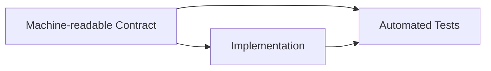

# ADR 003: HTTP API Contract Standards

**Status:** Accepted | **Date:** 2026-07-11 | **Review:** 2027-07-11

## Context

HTTP APIs need stable, discoverable contracts so consumers can integrate safely and
teams can test security and compatibility. Existing domain or protocol standards
should be preferred over bespoke HTTP APIs where they meet the service need.

**Compliance Requirements:**

- [ACSC Software Development Guidelines](https://www.cyber.gov.au/resources-business-and-government/essential-cyber-security/ism/cyber-security-guidelines/guidelines-software-development)
- [OWASP API Security](https://owasp.org/www-project-api-security/)
- [OpenAPI Specification](https://spec.openapis.org/)

## Decision

### Applicability

This ADR applies to new or materially changed HTTP APIs controlled by the agency,
including public, partner, administrative, and service-to-service APIs. The depth of
documentation and testing should reflect the API's consumers, data sensitivity, and
operational risk.

It does not require OpenAPI for non-HTTP protocols, event streams, GraphQL schemas,
static web routes, health probes with no business contract, or third-party APIs the
agency cannot change. Use the applicable protocol-native contract for those
interfaces. This ADR does not mandate REST, public documentation, an API gateway, or
a particular framework or test product.

### API Requirements

Applicable APIs must have automated contract conformance, behaviour, and security
testing in CI/CD.

| Capability | Requirement |
|------------|-------------|
| **Contract** | Keep a version-controlled, machine-readable contract for applicable HTTP APIs. Use [OpenAPI](https://spec.openapis.org/) where it can accurately describe the HTTP request and response contract. |
| **Compatibility** | Define naming, versioning, error, pagination, and deprecation conventions appropriate to the API and its consumers. |
| **Testing** | Automate contract conformance, behaviour, and security testing in CI/CD. Tests must cover material operations and security risks. |
| **Security** | Apply authentication, authorisation, input validation, rate or resource controls, logging, and relevant [OWASP API Security](https://owasp.org/www-project-api-security/) guidance according to risk. |
| **Administration** | Keep administrative operations off public networks by default. Where Internet access is necessary, require an approved exposure design with strong identity, least privilege, restricted access where practical, audit logging, monitoring, and protective edge controls. |

### Development Guidelines

- Prefer contract-first development or frameworks that generate the contract from
  code, provided the published contract is reviewed and tested for drift.
- Prefer standard data types and formats over custom encodings.
- Separate APIs by purpose and trust boundary where this reduces privilege or
  exposure (see [Reference Architecture: OpenAPI
  Backend](../reference-architectures/openapi-backends.md)).
- Use any maintained tools that satisfy the testing requirement. Examples include
  [Restish](https://rest.sh/#/openapi), framework-native tests, schema validators,
  fuzzers, and dynamic security test tools.
- Frameworks such as [Huma](https://huma.rocks/) and
  [Litestar](https://litestar.dev/) are implementation examples, not requirements.

**API Development Flow:**

Generate or maintain the contract with the implementation, then validate both with
automated contract, security, and behaviour tests.

### Legacy Adoption

Existing APIs do not need a disruptive rewrite. Inventory consumers and sensitive
operations first, capture the current contract, add tests around high-risk and
frequently changed behaviour, and address drift through normal change delivery.
Record a prioritised improvement plan for material gaps.

## Required Evidence

- Version-controlled contract and compatibility or deprecation policy
- CI/CD results for contract, behaviour, and security tests
- Security review and approved exposure design for Internet-accessible
  administrative operations
- Consumer communication and migration evidence for breaking changes

## Exceptions

Where OpenAPI cannot accurately describe an applicable HTTP API, record the reason
and use a maintained machine-readable alternative where available. Deferring a
required contract, test, or exposure control requires documented scope, consumer and
security impact, compensating controls, accountable approval, an expiry date, and a
remediation plan.

## Consequences

**Benefits:**

- Consistent, testable API contracts
- Enhanced security through consistent validation patterns
- Reduced integration and maintenance overhead through automated testing

**Risks if not implemented:**

- Documentation drift creating integration difficulties
- Security vulnerabilities from inconsistent API patterns
- Increased development time debugging undocumented APIs
