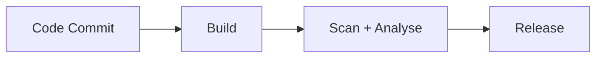

# ADR 004: CI/CD Quality Assurance

**Status:** Accepted | **Date:** 2026-07-11 | **Review:** 2027-07-11

## Context

Ensure security and integrity of software artifacts that are consumed by
infrastructure repositories per [ADR 010](../operations/010-configmgmt.md).
Threat actors exploit vulnerabilities in code, dependencies, container
images, and exposed secrets.

**Compliance Requirements:**

- [OWASP CI/CD Security](https://cheatsheetseries.owasp.org/cheatsheets/CI_CD_Security_Cheat_Sheet.html)
- [ACSC Software Development Guidelines](https://www.cyber.gov.au/resources-business-and-government/essential-cyber-security/ism/cyber-security-guidelines/guidelines-software-development)

## Decision

### Applicability

This ADR applies to pipelines that build, test, package, release, or deploy agency
software. Controls should be proportionate to artifact type, exposure, data
sensitivity, and deployment privilege. Documentation-only repositories and
short-lived prototypes that cannot be released may use a reduced pipeline approved
by the repository owner.

It does not mandate a CI/CD platform, cloud provider, container format, or deployment
service. It controls build-time and released-artifact assurance; it does not replace
deployed asset discovery, patching, endpoint application control, or operational
vulnerability management.

### CI/CD Pipeline Requirements

**Pipeline Flow**: Code Commit → Build & Test → Quality Assurance → Release

| Capability | Requirement | Example tools |
|------------|-------------|---------------|
| **Build** | Repeatable builds with integrity information, SBOM, and provenance for released artifacts | [Docker Bake](https://docs.docker.com/build/bake/) |
| **Security scan** | Automated secret, dependency, artifact, and applicable configuration scanning | [Trivy](https://trivy.dev/latest/docs/) and platform-native scanners |
| **Analysis** | Automated static analysis and maintainability checks appropriate to the codebase | [GitHub CodeQL](https://docs.github.com/en/code-security/code-scanning/introduction-to-code-scanning/about-code-scanning-with-codeql), [scc](https://github.com/boyter/scc) |
| **Test** | Automated unit and integration tests, plus end-to-end tests for material user journeys | [Playwright](https://playwright.dev/docs/intro) and framework-native tools |
| **Performance** | Risk-based performance and capacity testing for services with defined performance objectives | [Grafana k6](https://grafana.com/docs/k6/latest/) |
| **API** | Contract, behaviour, and security testing where [ADR 003](../development/003-apis.md) applies | [Restish](https://rest.sh/#/guide) and equivalent API test tools |

Mandatory security checks must fail the pipeline when an artifact contains an
unapproved critical finding, a confirmed secret, an applicable unsupported runtime
or base image, or incomplete provenance. A documented, time-bound exception is
required before release when a finding cannot be remediated within the applicable
agency or ACSC timeframe.

### Execution Environment

- Pin a consistent local and CI toolchain. The WA Government
  [devcontainer-base](https://github.com/wagov-dtt/devcontainer-base) is one option.
- Define repeatable build and task commands. [Docker Bake](https://docs.docker.com/build/bake/)
  and [Just](https://just.systems/man/en/) are examples.
- Keep unprivileged build, test, and scan work on an agency-approved CI platform.
  [GitHub Actions](https://docs.github.com/en/actions/about-github-actions/understanding-github-actions)
  and [Woodpecker CI](https://woodpecker-ci.org/) are examples.
- Run cloud-privileged release and deployment steps only in an agency-approved
  trust boundary with protected environments, short-lived identity, and
  operations-controlled production access.

### Cloud-Privileged Automation

Keep privileged steps separate from general CI where release or deployment needs
cloud credentials or direct access to protected systems. Repository-hosted or
self-hosted automation may be used where it meets the required trust, identity,
network, approval, and audit controls.

Required controls:

- Obtain short-lived, least-privilege workload credentials at runtime; do not store
  long-lived cloud credentials in pipeline systems where federation or managed
  identity is supported
- Use dedicated, operations-managed hosts or workloads where the risk assessment
  requires isolation
- Limit network access to the cloud services and internal systems required for the
  job
- Apply strong access control, audit logging, and minimal administrative
  access
- Keep build, release, and deployment logs for audit and incident review
- Separate development, test, release, and production roles; developers
  must not use standing production deployment credentials
- Pin and verify third-party actions, dependencies, build images, and release
  artifacts using immutable versions and integrity information
- Generate and retain a Software Bill of Materials (SBOM) and build
  provenance for every released artifact
- Continuously rescan supported release artifacts and dependencies so newly
  disclosed vulnerabilities enter the vulnerability-management process

Official cloud-native options include:

| Cloud | Workload identity | Deployment option examples |
|-------|-------------------|----------------------------|
| AWS | [IAM OIDC federation and temporary roles](https://docs.aws.amazon.com/IAM/latest/UserGuide/id_roles_providers_create_oidc.html) | OpenTofu or Terraform under ADR 010, or [AWS CodeDeploy](https://docs.aws.amazon.com/codedeploy/latest/userguide/welcome.html) for application deployment |
| Azure | [Microsoft Entra workload identity federation](https://learn.microsoft.com/en-us/entra/workload-id/workload-identity-federation) or managed identities | OpenTofu or Terraform under ADR 010 |
| Google Cloud | [Workload Identity Federation](https://cloud.google.com/iam/docs/workload-identity-federation) or service account impersonation | OpenTofu or Terraform under ADR 010, or [Cloud Deploy](https://cloud.google.com/deploy/docs/overview) for application deployment |

These products are examples, not requirements. Equivalent approved services may be
used when they provide the same identity, approval, integrity, and audit controls.

**CI/CD Pipeline:**

Build produces release artifacts with SBOM/provenance. Scan runs vulnerability and
static analysis. Release publishes immutable artifacts consumed by
[ADR 010: Infrastructure as Code](../operations/010-configmgmt.md).
Keep unprivileged build, test, and scan work on general CI, including long-running
jobs. Isolate only the cloud-privileged release or deployment steps that need the
stronger trust boundary.

### Legacy Adoption

Existing pipelines should first inventory release paths and credentials, remove
standing production credentials, and protect deployment environments. Introduce
artifact integrity, security gates, SBOM/provenance, and broader testing in a
risk-prioritised plan rather than blocking all legacy releases at once.

## Required Evidence

- Pipeline definitions and protected-branch settings
- Scan, test, secret-detection, SBOM, and provenance results for each release
- Approval and deployment records demonstrating role and environment
  separation
- Linked vulnerability or exception record for any accepted finding

## Exceptions

Bypassing a mandatory security gate requires compensating controls,
residual risk, accountable executive approval, an expiry date, and a linked
remediation plan. Emergency releases must run deferred checks immediately
after deployment.

## Consequences

**Benefits:**

- Automated security scanning and vulnerability remediation
- Standardised artifact integrity and compliance alignment
- Consistent deployment pipelines with audit trails
- Clear separation between general CI checks and cloud-privileged
  automation

**Risks if not implemented:**

- Vulnerable containers deployed to production
- Exposed secrets or excessive cloud privilege in automation systems
- Manual security processes prone to human error
- Compliance violations and audit failures

## References

- [ADR 003: HTTP API Contract Standards](../development/003-apis.md)
- [ADR 010: Infrastructure as Code](../operations/010-configmgmt.md)
