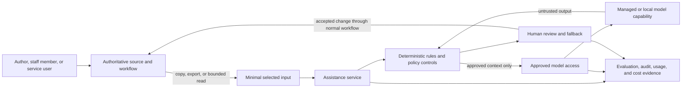

# Reference Architecture: AI-Assisted Digital Services

**Status:** Proposed | **Date:** 2026-07-11 | **Review:** 2027-07-11

## Purpose

This informative reference architecture composes existing ADRs for agencies of
different sizes and technology estates. It does not approve an AI use case,
provider, model, or new mandatory control. ADRs identified as Proposed below are
proposed dependencies, not accepted requirements.

Start with a low-risk, standalone companion. Keep the source system
authoritative and make a person accountable for every official outcome. Increase
integration only when evaluation and operational evidence justify it.

## Applicability and Non-Goals

Use this pattern for bounded assistance such as:

- Drafting, summarising, rewriting, translation support, and plain-English
  coaching
- Content, form-help, search-help, or staff support over approved information
- Explanations of curated reports and service information
- Read-only retrieval or selected-field assistance with a defined human review

This pattern is not approval for automated eligibility, policy, enforcement,
fraud, identity, payment, publishing, production change, or other consequential
decisions. It is not a basis for unrestricted agents, broad data access, or
privileged tools. Assess those uses separately under [ADR 011: AI Tool and Agent
Governance](../security/011-ai-governance.md).

AI output can identify possible issues, but cannot prove policy, factual, legal,
records, privacy, or accessibility compliance. Qualified human review and
representative testing remain necessary.

## Prerequisites and Assumptions

Before implementation, confirm:

- An accountable service owner and AI accountable officer, a defined use case,
  excluded uses, users, affected people, and human decision boundary
- An initial ADR 011 risk tier based on data, consequence, autonomy, privilege,
  reversibility, and detectability
- Agency information classification, privacy, records, procurement, security,
  offshoring, and accessibility owners are available as applicable
- A source of representative, lawfully usable evaluation material and qualified
  reviewers exists
- The source workflow can continue without AI and remains the system of record
- Identity, logging, support, incident, and supplier-management capabilities are
  available in proportion to the tier

## Architecture Variants

| Variant | Shape | Appropriate starting point |
|---------|-------|----------------------------|
| Minimum: low-risk companion | Copy/paste, approved file upload, or static export; deterministic checks; model call with minimal context; no retrieval, write-back, or tools | Non-sensitive, advisory, reversible work and proofs of value |
| Higher-assurance: bounded integration | Authenticated read-only feed or selected fields; policy enforcement; approved retrieval corpus where needed; schema-constrained output; explicit human gate; no broad or implicit tool access | Moderate or higher consequence, organisational data, repeated workflows, or deeper integration after assurance |

High-risk use may need an independently assured design rather than either
variant. Inline write-back, agentic tools, memory, or consequential automation
are separate scope changes and trigger risk-tier reassessment.

Delivery can progress from manual companion, to file-based review, to read-only
feed, and then to bounded inline assistance. Start with the least integrated
level that can test the service outcome.

## Capability View

The model is outside the trust boundary for truth and instructions. Validate
input and output, keep provider credentials server-side, and do not let content
supplied by users or retrieval sources redefine system policy or approval gates.

## Provider, SaaS, and Local Options

Product links are implementation examples, not preferences or approvals:

| Option | Official examples | Considerations |
|--------|-------------------|----------------|
| AWS managed model access | [Amazon Bedrock](https://docs.aws.amazon.com/bedrock/latest/userguide/what-is-bedrock.html) | Validate model, feature, region, retention, network, logging, and contract fit |
| Microsoft managed model access | [Microsoft Foundry](https://learn.microsoft.com/en-us/azure/foundry/what-is-foundry) and [Azure OpenAI](https://learn.microsoft.com/en-us/azure/ai-foundry/openai/overview) | Foundry capabilities and Azure OpenAI deployments are not interchangeable |
| Google Cloud managed model access | [Vertex AI generative AI](https://cloud.google.com/vertex-ai/generative-ai/docs/learn/overview) | Validate model availability, data handling, region, safety controls, and quotas |
| Approved AI SaaS or API | Agency-contracted service with documented enterprise data terms and export/deletion support | Consumer accounts and enterprise services are not equivalent |
| Local or self-hosted inference | Supported runtimes such as [Ollama](https://docs.ollama.com/) or [vLLM](https://docs.vllm.ai/) | Local processing can reduce disclosure but transfers patching, model provenance, capacity, monitoring, and recovery duties to the agency |
| Existing or legacy capability | Supported agency inference platform, approved API gateway, or manual workflow | Retain where it meets the same use-case, evidence, support, and exit needs |

These options are not equivalent in model behaviour, data processing, location,
retention, training use, content filtering, identity, private connectivity,
logging, availability, quotas, cost, or deletion. Evaluate the configured
service, model, and region rather than relying on a product family statement.

A client may call one approved managed endpoint through a small server-side
adapter, or use an internal gateway when central policy, credential isolation,
multiple applications, or provider portability justify it. An Open
Responses-compatible interface, [Bedrock
Mantle](https://docs.aws.amazon.com/bedrock/latest/userguide/bedrock-mantle.html),
[Hugo](https://gohugo.io/) previews, and [Bootstrap](https://getbootstrap.com/)
are optional implementation examples, not defaults. Frontends and previews
follow the applicable agency design system under proposed ADR 020.

Use OpenTofu, or Terraform where justified, for provisionable infrastructure
under [ADR 010: Infrastructure and Configuration as
Code](../operations/010-configmgmt.md). Keep model IDs, prompt versions, limits,
provider settings, and deployment configuration versioned and reviewable; do not
place provider credentials in browsers, CMS plugins, or portal widgets.

## Project Kickoff Outputs

Produce these before build or procurement is committed:

- Service brief with intended users and outcomes, non-goals, human fallback,
  accountable owners, initial risk tier, and risk-tier change triggers
- Current and proposed data-flow diagrams showing fields, classification,
  volumes, prompts, retrieval, outputs, logs, locations, subprocessors, and
  deletion paths
- Privacy, information-classification, offshoring, security, records, and
  supplier assessments proportionate to the use case
- Architecture variant and build/buy/local selection record, including
  non-equivalence, accessibility, total cost, support, and exit criteria
- Evaluation plan with representative corpus, prohibited outcomes, quality and
  safety measures, reviewer roles, thresholds, and regression cadence
- Threat model covering prompt injection, adversarial input, retrieval
  poisoning, data leakage, unsafe output, denial of service, and privilege abuse
- Service level objectives (SLOs), cost and usage limits, runbook, incident and
  complaint paths, and launch/rollback criteria

## Data, Privacy, and Supplier Controls

- Send selected fields or curated extracts rather than complete records; remove
  unnecessary personal information, identifiers, comments, attachments, and
  workflow metadata
- Record classification at every data-flow boundary, including prompt,
  retrieval corpus, output, telemetry, support access, and provider abuse logs
- Assess processing and support locations, subprocessors, cross-border access,
  model-training use, retention, deletion, legal terms, incidents, and exit;
  apply [WA Data Offshoring
  Governance](https://www.wa.gov.au/system/files/2025-06/dataoffshoringgovernancewithwadataoffshoringposition.pdf)
- Configure no-training and minimum-retention options where supported, but verify
  contract and observed behaviour rather than assuming a flag proves compliance
- Keep required agency evidence in agency-controlled systems and avoid logging
  sensitive prompt or output content unless specifically justified and protected

## Evaluation, Safety, and Accessibility

- Freeze a versioned evaluation corpus that represents languages, content
  types, accessibility needs, edge cases, and affected cohorts without using
  data unlawfully
- Record baseline and release results by model, model version, prompt, retrieval
  version, configuration, and reviewer; investigate subgroup and failure results
- Test direct and indirect prompt injection, policy override, malicious files,
  encoded instructions, data exfiltration, unsafe links, denial-of-service
  inputs, and malformed or deceptive outputs
- Run deterministic checks before model calls where rules are known and validate
  schema, citations, claims, links, and actions after model calls as applicable
- Clearly label assistance, uncertainty, and the human review step; provide a
  usable non-AI path when the model is unavailable, declined, or inappropriate
- Test the entire interface and fallback with representative users and
  assistive technology against WCAG 2.2 AA; generated text or an AI
  accessibility review is not accessibility evidence

## Roles and Operations

| Role | Operational accountability |
|------|----------------------------|
| Service owner | Outcome, risk acceptance, funding, SLO, human fallback, and retirement |
| AI accountable officer or governance owner | Tier, approval, inventory, reassessment, and escalation |
| Product, content, or business owner | Source quality, workflow, qualified review, and official use of outputs |
| Engineering and platform team | Boundaries, deployment, model access, limits, observability, rollback, and recovery |
| Security, privacy, records, procurement, and data owners | Classification, threats, notices, retention, offshoring, supplier terms, and incidents |
| Accessibility and user-research leads | Inclusive journeys, non-AI alternative, testing, and remediation |
| Service desk and operations | User support, complaints, model/provider incidents, and runbook exercises |

Maintain an inventory of use cases, owners, providers, models and versions,
prompts and versions, retrieval sources, tools, data classes, locations, expiry
dates, and approvals. Monitor latency, availability, refusals, harmful or invalid
outputs, policy denials, injection attempts, token use, spend, user overrides,
and fallback use. Enforce per-user and service quotas, token ceilings, budget
alerts, and a tested stop switch.

## Resilience, Recovery, and Exit

Set SLO, RTO, and RPO according to service consequence. Define behaviour for
model, provider, gateway, network, quota, safety-filter, and logging failure.
Prefer fail-safe human fallback over silent provider or model substitution;
re-evaluate before switching because models are not equivalent.

Recover versioned prompts, policy, evaluation assets, infrastructure, and
configuration independently of provider conversation state. Test restore,
credential rotation, model disablement, and operation without AI.

Before production, demonstrate that the agency can export its model/prompt
inventory, configuration, logs, evaluations, and approved outputs; replace the
provider or return to the manual workflow; revoke access; and request and verify
deletion under the contract. Record a timed provider-exit and deletion test,
including residual backups or legal retention. Avoid proprietary model features
unless their value and exit impact are accepted.

## Required Artifacts and Acceptance Checks

To claim adoption of this pattern, retain:

- [ ] Approved use case, owners, risk tier, architecture variant, and excluded
      actions
- [ ] Data flow, classification, privacy/offshoring, supplier, records, security,
      and accessibility assessments applicable to the use case
- [ ] Representative evaluation corpus, thresholds, baseline, release results,
      qualified review, and known-limit register
- [ ] Prompt-injection and adversarial test results with remediated or accepted
      findings
- [ ] Tested human fallback, stop switch, incident/complaint route, SLO, alerts,
      runbook, recovery, and rollback
- [ ] Enforced rate, token, and cost limits with owner alerts
- [ ] Current model, prompt, retrieval, tool, provider, region, and approval
      inventory
- [ ] Manual and automated accessibility results for the assistance and non-AI
      journeys; no claim based only on AI output
- [ ] Provider export, replacement, access-revocation, exit, and deletion-test
      evidence
- [ ] Infrastructure plans and apply records using OpenTofu or Terraform where
      infrastructure is provisioned

## Related ADRs

Accepted ADRs commonly composed by this pattern:

- [ADR 001: Application Isolation](../security/001-isolation.md)
- [ADR 003: HTTP API Contract Standards](../development/003-apis.md)
- [ADR 004: CI/CD Quality Assurance](../development/004-cicd.md)
- [ADR 005: Secrets Management](../security/005-secrets-management.md)
- [ADR 007: Centralised Security Logging](../operations/007-logging.md)
- [ADR 009: Release Standards](../development/009-release.md)
- [ADR 010: Infrastructure and Configuration as Code](../operations/010-configmgmt.md)
- [ADR 011: AI Tool and Agent Governance](../security/011-ai-governance.md)
- [ADR 013: Identity Federation Standards](../security/013-identity-federation.md)
- [ADR 020: Frontend UI Foundations](../development/020-frontend-ui-foundations.md)

Proposed dependencies, to apply only if adopted or otherwise approved for the
project:

- [ADR 021: Workload mTLS and Service Authorisation](../security/021-workload-mtls.md),
  when agency-managed components run on Kubernetes
