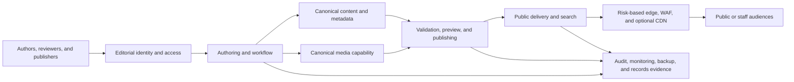

# Reference Architecture: Content Management

**Status:** Accepted | **Date:** 2026-07-11 | **Review:** 2027-07-11

## Purpose

This informative reference architecture composes existing ADRs for agencies of
different sizes, delivery models, and legacy estates. It does not select a CMS,
require a cloud migration, or create new mandatory controls. ADRs identified as
Proposed below are proposed dependencies, not accepted requirements.

## Applicability and Non-Goals

Use this pattern for public websites, intranets, content portals, headless or
multi-channel content, editorial workflows, and static publishing that needs
content ownership, review, repeatable release, or lifecycle management.

A simple site can use only the static-publishing capabilities. A SaaS CMS or a
supported legacy platform can satisfy the pattern without reproducing every
component in the diagrams.

This pattern is not a case-management or transactional system, records
management system, general document repository, digital-asset-management
standard, or data-pipeline architecture. Integrations may connect those systems,
but the authoritative owner and lifecycle of each record must remain explicit.

## Prerequisites and Assumptions

Before selecting a product or hosting model, confirm:

- Service, content, technical, security, privacy, records, and accessibility
  owners and the author, reviewer, approver, publisher, and administrator roles
- Audiences, critical public and editorial journeys, applicable agency design
  system, supported languages, channels, browsers, devices, and assistive
  technologies
- Content types, metadata, search and integration needs, publication rules,
  classification, records obligations, retention/disposal authority, and
  privacy notices or consent needs
- Service criticality, traffic profile, RTO, RPO, support hours, data-location
  constraints, procurement route, budget, and platform capability
- Current content, media, URLs, redirects, integrations, customisations,
  licences, and supported legacy dependencies

## Architecture Variants

| Variant | Shape | Typical fit |
|---------|-------|-------------|
| Minimum: static publishing | Approved file, Git, SaaS, or headless authoring; controlled build; static web origin; optional object-backed media and CDN | Small public sites, campaigns, guidance, or low-change content with simple approvals |
| Simple: SaaS CMS | Contracted authoring and workflow with vendor-managed runtime or delivery; agency identity, configuration, export, and assurance | Agencies seeking low operating overhead where data, accessibility, integration, records, and exit needs are met |
| Managed runtime | Supported CMS on managed application/container runtime with managed database and separately selected media/delivery capabilities | Custom workflows, integrations, or control that justify agency operation; Kubernetes only where workload needs it |
| Higher-assurance separated delivery | Authoring is not Internet-reachable from the public path; approved content is published to a separate static, headless, or read-only delivery tier | Higher availability or security consequence, predictable public content, or strong origin isolation needs |
| Supported legacy | Existing CMS and hosting retained with current support, hardening, monitoring, recovery, accessibility improvement, and an exit plan | Migration risk or cost exceeds near-term benefit and residual risks are accepted |

Variants can be combined. SaaS authoring can publish statically; a managed CMS
can use headless delivery; and legacy authoring can feed a modern public tier.
Products and variants are not assurance levels by themselves.

## Capability View

The capabilities can be delivered by one SaaS product or several agency-managed
components. Keep editorial administration separate from anonymous delivery
where practical, and prevent the public path from gaining authoring privileges.

## Storage and Edge Choices

Do not assume a CDN, WAF, object store, or shared file service is always needed:

- Apply agency-approved, risk-appropriate edge and DDoS protection to
  Internet-facing services under [ADR 016: Web Application Edge
  Protection](../security/016-edge-protection.md). Use a WAF when HTTP threats
  warrant it and a CDN when caching, origin shielding, performance, or capacity
  has a documented benefit.
- Prefer object-backed origins for cacheable static and media assets where the
  CMS and processing tools support object semantics. Do not treat object storage
  as a general file system.
- Apply [ADR 019: Shared File Access](../operations/019-shared-file-access.md)
  when the CMS, migration, or media-processing workload needs paths, NFS/SMB,
  locking, atomic changes, or other tested file semantics. Define one canonical
  store and avoid uncontrolled dual writes.
- Keep private, draft, personal, licensed, security-sensitive, or embargoed
  content out of public origins and caches. Test cache keys, invalidation,
  direct-origin blocking, and rollback for the selected publication design.

## Provider, SaaS, and Legacy Options

Product links are implementation examples, not preferences or approvals:

| Option | Official examples | Notes |
|--------|-------------------|-------|
| AWS building blocks | [AWS App Runner](https://docs.aws.amazon.com/apprunner/latest/dg/what-is-apprunner.html), [Amazon RDS](https://docs.aws.amazon.com/AmazonRDS/latest/UserGuide/Welcome.html), [Amazon S3](https://docs.aws.amazon.com/AmazonS3/latest/userguide/Welcome.html), and [Amazon CloudFront](https://docs.aws.amazon.com/AmazonCloudFront/latest/DeveloperGuide/Introduction.html) | Select only the runtime, data, media, and edge capabilities the variant needs |
| Azure building blocks | [Azure App Service](https://learn.microsoft.com/en-us/azure/app-service/overview), [Azure Database for PostgreSQL](https://learn.microsoft.com/en-us/azure/postgresql/flexible-server/overview), [Azure Blob Storage](https://learn.microsoft.com/en-us/azure/storage/blobs/storage-blobs-introduction), and [Azure Front Door](https://learn.microsoft.com/en-us/azure/frontdoor/front-door-overview) | Service plans, database engines, storage semantics, and edge features vary |
| Google Cloud building blocks | [Cloud Run](https://cloud.google.com/run/docs/overview/what-is-cloud-run), [Cloud SQL](https://cloud.google.com/sql/docs/introduction), [Cloud Storage](https://cloud.google.com/storage/docs/introduction), and [Cloud CDN](https://cloud.google.com/cdn/docs/overview) | Validate runtime compatibility, location, support, and origin design |
| SaaS CMS | Agency-assessed services such as [Contentful](https://www.contentful.com/developers/docs/) or [WordPress VIP](https://docs.wpvip.com/) | Contract, authoring accessibility, identity, data handling, extensibility, operational responsibility, portable export, and deletion differ |
| Local or legacy | Supported agency or vendor CMS, static generator, web server, database, and file/object platform | Retain only with named support, patching, backup, monitoring, capacity, accessibility, and migration ownership |

These products are not equivalent. Validate content model and workflow fit,
Australian region and support access, identity, accessibility, APIs, extension
model, file semantics, performance, recovery, licensing, cost, export, deletion,
and service responsibility. Managed and SaaS services do not transfer agency
accountability for content, records, privacy, security, or accessibility.

Use OpenTofu, or Terraform where justified, for provisionable infrastructure
under [ADR 010: Infrastructure and Configuration as
Code](../operations/010-configmgmt.md). Provider-native tooling is an exception
or bootstrap option as described by that ADR. Keep CMS schema, workflow,
templates, configuration, redirects, and deployment inputs versioned and
recoverable where the product permits.

## Project Kickoff Outputs

Produce these before procurement or implementation is committed:

- Service and content brief with users, critical editorial and public journeys,
  scope, non-goals, ownership, variant, service tier, and measurable outcomes
- Content and records inventory covering types, owners, classification,
  personal information, retention/disposal authority, languages, media, URLs,
  redirects, search, integrations, and migration disposition
- Capability and responsibility map identifying agency, platform, SaaS, and
  supplier duties for authoring, delivery, security, operations, and support
- Architecture and data-flow diagrams showing authoring and public trust
  boundaries, stores, locations, publication, cache, logs, backup, and deletion
- Product/options assessment covering non-equivalence, whole-of-life cost,
  design-system fit, authoring and public accessibility, support, recovery,
  portable export, and exit
- Acceptance plan for editorial and public paths, content/media/redirect
  migration, accessibility, performance, security, recovery, and decommission

## Content, Records, Privacy, and Classification

- Apply the agency's records plan, retention and disposal authorities, legal
  holds, ownership, and evidence requirements to drafts, approvals, published
  content, media, forms, audit events, and exports as applicable.
- Apply agency privacy assessment, notices, consent, minimisation, access,
  correction, breach, and disposal processes. Do not collect analytics,
  personalisation, form, or cookie data merely because the CMS supports it.
- Classify content, media, metadata, logs, backups, preview environments, and
  support exports; approve every storage, administration, support, backup, and
  offshoring location.
- Keep approval history and official records in an agency-approved system. A
  CMS workflow or vendor audit log is evidence only if agency records owners
  accept its completeness, retention, integrity, access, and export.
- ADR 015 concerns data-pipeline contracts, quality, and lineage. It applies to
  a CMS data pipeline when relevant, but it is not the authority for CMS records
  retention or disposal.

## Editorial, Public, and Accessibility Acceptance

Test end-to-end editorial journeys for sign-in, draft, preview, compare, review,
approval, scheduling, publishing, correction, unpublishing, restore, and urgent
release. Verify least privilege, separation of approval where needed, audit
events, notifications, concurrent editing, and safe failure.

Test public journeys for navigation, search, forms and integrations, language,
media, metadata, canonical URLs, redirects, error pages, cache behaviour,
performance, mobile use, and degraded dependencies. Use the applicable agency
design system under proposed ADR 020, not Bootstrap as a default.

Assess authoring accessibility as well as public templates. Include keyboard,
screen reader, zoom/reflow, focus, labels, errors, rich-text editing, media/alt
text, preview, and approval with representative authors with disability. Where a
vendor authoring interface has barriers, provide an effective accessible path
and a time-bound remediation or replacement decision. Test public output against
WCAG 2.2 AA using automated and manual methods.

An optional AI review companion may use [AI-Assisted Digital
Services](ai-assisted-digital-services.md), starting with copy/paste, export, or
read-only preview. It must not approve, publish, change workflow state, or be
treated as proof of policy or accessibility compliance.

## Roles and Operations

| Role | Operational accountability |
|------|----------------------------|
| Service owner | Outcome, funding, risk, SLO, continuity, supplier, and retirement |
| Content owner and publishing lead | Model, quality, approvals, records capture, publishing calendar, and corrections |
| Authors, reviewers, and publishers | Accessible content, metadata, evidence, and role-appropriate workflow actions |
| Product/design/accessibility team | Research, information architecture, agency design system, public and authoring usability, and WCAG testing |
| Engineering/platform team | Runtime, integration, infrastructure as code, deployment, observability, performance, recovery, and technical exit |
| Security, privacy, records, and information owners | Access, classification, assessments, retention/disposal, incidents, and assurance |
| Supplier and service desk | Contracted operation, support, escalation, accessibility defects, incidents, and knowledge transfer |

Monitor public availability and latency, publishing success and age, broken
links, search, forms, origin and cache errors, capacity, certificate/domain
expiry, security events, privileged and editorial actions, backups, integrations,
and supplier status. Keep an on-call or support model proportionate to service
criticality and exercise publishing, correction, incident, and supplier
escalation runbooks.

## Resilience and Recovery

Derive SLO, RTO, and RPO from public impact and content-change tolerance. Define
behaviour for authoring, database, media, build, search, integration, DNS, edge,
and supplier failure. A static or last-known-good public tier can preserve
read-only information while authoring is unavailable, but stale or time-critical
content needs an owner, visible handling, and an emergency correction path.

Back up and test recovery of content, media, database, configuration, templates,
redirects, identity mappings, keys/procedures, infrastructure code, release
artifacts, and required audit evidence. ADR 014 describes the
independent-copy pattern; document its implementation rather
than treating snapshots, replication, or SaaS availability as proof of backup.
Exercise isolated restoration and republishing against measured RTO/RPO.

## Migration and Exit

Inventory and map content, owners, metadata, status, languages, relationships,
media, licences, alt text, renditions, URLs, redirects, search data,
integrations, users, approvals, and records disposition. Clean up only with
owner and records approval.

Rehearse export, transformation, checksum/count reconciliation, link and redirect
validation, permissions, preview, accessibility, performance, cutover, rollback,
and delta migration. Preserve high-value URLs and test redirects from external
referrers. Avoid uncontrolled publishing to both platforms.

Before production, demonstrate a portable, documented export of content,
metadata, media, relationships, workflow/approval evidence, redirects, and
configuration available under the contract. Test import into an independent
tool or target where practical. After acceptance and required retention, revoke
access, stop integrations and billing, remove DNS and secrets, obtain supplier
deletion evidence, securely dispose of residual copies, and record platform
decommission.

## Required Artifacts and Acceptance Checks

To claim adoption of this pattern, retain:

- [ ] Scope, owners, prerequisites, architecture variant, responsibility map,
      data flow, and product/options assessment
- [ ] Content/records inventory and approved classification, privacy, location,
      offshoring, retention/disposal, and supplier decisions
- [ ] Versioned content model, workflow, role matrix, templates/design-system
      decision, integration contracts, media ownership, and redirect register
- [ ] Editorial-path acceptance results, including authoring accessibility and
      safe publishing/correction failure modes
- [ ] Public-path acceptance results, including representative WCAG 2.2 AA,
      security, cache/origin, browser/device, performance, search, link, form,
      media, and redirect tests
- [ ] SLO/RTO/RPO, dashboards and alerts, support/runbooks, independent recovery
      approach where applicable, and successful restore/republish exercise
- [ ] Content, media, and redirect migration reconciliation with cutover and
      rollback results
- [ ] Portable export/import test, access revocation, supplier deletion, records
      disposition, and source decommission evidence
- [ ] OpenTofu or Terraform plans and apply records for provisioned
      infrastructure, with documented exceptions under ADR 010

## Related ADRs

Accepted ADRs commonly composed by this pattern:

- [ADR 001: Application Isolation](../security/001-isolation.md)
- [ADR 002: Managed Kubernetes for Compatible Workloads](../operations/002-workloads.md)
- [ADR 003: HTTP API Contract Standards](../development/003-apis.md)
- [ADR 004: CI/CD Quality Assurance](../development/004-cicd.md)
- [ADR 005: Secrets Management](../security/005-secrets-management.md)
- [ADR 007: Centralised Security Logging](../operations/007-logging.md)
- [ADR 009: Release Standards](../development/009-release.md)
- [ADR 010: Infrastructure and Configuration as Code](../operations/010-configmgmt.md)
- [ADR 013: Identity Federation Standards](../security/013-identity-federation.md)
- [ADR 016: Web Application Edge Protection](../security/016-edge-protection.md)
- [ADR 019: Shared File Access](../operations/019-shared-file-access.md)
- [ADR 014: Independent Backups and Recovery](../operations/014-object-backup.md)
- [ADR 018: Managed Relational Databases and Open Lakehouses](../operations/018-database-patterns.md)
- [ADR 020: Frontend UI Foundations](../development/020-frontend-ui-foundations.md)

Proposed dependencies, to apply only if adopted or otherwise approved for the
project:

- [ADR 021: Workload mTLS and Service Authorisation](../security/021-workload-mtls.md),
  when agency-managed CMS components run on Kubernetes
