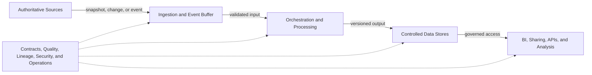

# Reference Architecture: Data Pipelines

**Status:** Accepted | **Date:** 2026-07-11 | **Review:** 2027-07-11

## Applicability and Non-Goals

Use this reference architecture for governed movement and transformation of
data across WA agency cloud, SaaS, and legacy environments, including:

- Scheduled extracts, file transfers, database replication, and batch ETL or
  ELT
- Event and change-data-capture pipelines where the business needs lower
  latency than a batch service can provide
- Curated datasets for business intelligence (BI), regulatory reporting,
  controlled sharing, data science, or downstream applications
- Warehouse or lakehouse implementations selected against explicit workload
  requirements

This is not an architecture for transactional request processing, an
operational API, master-data ownership, records-management policy, or ad hoc
movement of data without source and sharing authority. It does not mandate a
cloud, pipeline product, transformation framework, query engine, table format,
catalogue, notebook, or reporting tool.

[Ibis](https://ibis-project.org/), [DuckDB](https://duckdb.org/),
[DuckLake](https://ducklake.select/), [Amazon S3
Tables](https://docs.aws.amazon.com/AmazonS3/latest/userguide/s3-tables.html),
[Trino](https://trino.io/docs/current/connector/iceberg.html), and
[Quarto](https://quarto.org/) are optional implementation examples only. They
are not standards established by this reference architecture.

## How to Use This Reference Architecture

This reference architecture composes existing ADRs; it does not create a new
technology decision. Apply requirements from Accepted ADRs. A Proposed ADR is
a dependency under consideration, not an accepted standard: obtain the
project's required design and risk approval before relying on it, and record
any different project decision.

| Dependency | Status | Application in this pattern |
|---|---|---|
| [ADR 001: Application Isolation](../security/001-isolation.md) | Accepted | Administrative, network, environment, and workload boundaries |
| [ADR 002: Managed Kubernetes for Compatible Workloads](../operations/002-workloads.md) | Accepted | Kubernetes only when the workload-fit test is met |
| [ADR 004: CI/CD Quality Assurance](../development/004-cicd.md) | Accepted | Tested transformation, configuration, and release artifacts |
| [ADR 005: Secrets Management](../security/005-secrets-management.md) | Accepted | Source, sink, and service credentials |
| [ADR 007: Centralised Security Logging](../operations/007-logging.md) | Accepted | Operational, security, and data-access events |
| [ADR 009: Release Standards](../development/009-release.md) | Accepted | Promotion, rollback, and data-impact notes |
| [ADR 010: Infrastructure and Configuration as Code](../operations/010-configmgmt.md) | Accepted | OpenTofu or Terraform provisioning and controlled configuration |
| [ADR 014: Independent Backups and Recovery](../operations/014-object-backup.md) | Accepted | Independent copies, recovery objectives, and restore tests |
| [ADR 015: Data Pipeline Contracts, Quality and Lineage](../operations/015-data-governance.md) | Accepted | Contracts, thresholds, runtime lineage, quarantine, replay, and reconciliation |
| [ADR 017: Reproducible Analytical Publications](../operations/017-analytics-tooling.md) | Accepted, optional | Bounded analytical publications only, not enterprise BI |
| [ADR 018: Managed Relational Databases and Open Lakehouses](../operations/018-database-patterns.md) | Accepted | Warehouse, object storage, open-table, catalogue, and engine selection |
| [ADR 021: Workload mTLS and Service Authorisation](../security/021-workload-mtls.md) | **Proposed, conditional dependency** | Identity-based mTLS and east-west policy when pipeline services run on Kubernetes |

Agency obligations for privacy, information sharing, classification, records,
procurement, and offshoring still apply even where no repository ADR covers
them.

## Assumptions and Prerequisites

Before choosing products or creating production data movement, confirm:

- A business owner, source-system owner, data custodian, pipeline owner, and
  each consuming owner are named.
- The authoritative source and the authority to collect, use, transform, and
  share each dataset and attribute are documented. Technical access is not
  sharing authority.
- Purpose, consumers, classification, privacy obligations, retention and
  disposal authority, data location, and approved use restrictions are known.
- Source interfaces can provide a stable snapshot, change marker, event
  identifier, or other mechanism that supports complete and repeatable reads.
- Consumers can agree contracts, freshness and quality thresholds, planned
  outage handling, and breaking-change notification.
- Network paths, workload identities, encryption, key management, logging, and
  support coverage are available in every participating cloud and legacy
  environment.
- Business-approved recovery time objectives (RTOs), recovery point objectives
  (RPOs), maximum data latency, expected volume, concurrency, and cost envelope
  exist before service selection.

If a prerequisite is unavailable, record the gap, interim control, owner, and
resolution date rather than allowing a tool default to become the decision.

## Architecture and Capability Model

Keep the following logical capabilities identifiable even when one managed
product implements several of them:

| Capability | Provider-neutral responsibility |
|---|---|
| Source adapter | Authenticated, rate-limited read without bypassing source controls; captures source position or snapshot |
| Landing or event buffer | Durable hand-off, encryption, retention, duplicate handling, and replay boundary |
| Orchestration | Scheduling or event triggers, dependency state, retries, timeouts, backfill, and run identity |
| Processing | Versioned validation and transformation with deterministic or otherwise controlled results |
| Data stores | Purpose-separated landing, quarantine, curated, warehouse, lakehouse, or serving stores |
| Contract and schema control | Versioned meaning, types, keys, ownership, compatibility, and consumer notification |
| Quality and reconciliation | Approved thresholds, reason-coded failures, totals, alerts, disposition, and publication gates |
| Runtime lineage and catalogue | Executed source-to-output lineage, ownership, classification, location, contract, and discoverability metadata |
| Access and sharing | Workload and user access, purpose limitation, row or column controls where needed, and auditable release |
| Observability and cost | Run health, freshness, lag, throughput, data loss or duplication, resource use, and cost attribution |
| Recovery and exit | Independent backup, restore, replay, portable export, cutover, rollback, and decommissioning |

Do not infer that a product catalogue entry, replication setting, or source-code
graph supplies all of these capabilities. Validate the runtime evidence.

## Variants

### Minimum Batch Variant

Use for bounded datasets where an approved schedule meets the maximum data
latency and the source supports repeatable extraction.

- Use one managed scheduler or existing supported enterprise scheduler, a
  fit-for-purpose execution service, encrypted landing and curated storage,
  and a governed serving interface.
- Capture a source snapshot identifier or high-water mark and a unique run ID.
  Make writes idempotent through stable business keys, partition replacement,
  merge semantics, or another tested method.
- Define safe rerun and backfill windows. A failed run must not silently append
  duplicates, publish partial output, or advance the source checkpoint.
- Apply contracts, blocking and warning quality thresholds, runtime lineage,
  quarantine, replay, and source-to-output reconciliation under Proposed ADR
  015 or an approved project-equivalent decision.
- Prefer private connectivity and workload identity. Use an approved managed
  file-transfer gateway when a legacy endpoint supports only files or SFTP.

This is the minimum production shape, not a relaxation of classification,
privacy, backup, or operational controls.

### Higher-Assurance Batch Variant

Use when data sensitivity, public impact, statutory reporting, volume, or
recovery objectives justify additional controls.

- Separate source landing, processing, quarantine, curated publication, and
  backup administration according to ADR 001 trust boundaries.
- Preserve immutable source extracts or equivalent reproducible source
  snapshots for the approved replay period.
- Require independent control totals or record-level reconciliation and
  approval before publication for high-consequence outputs.
- Run representative performance, restore, corruption, partial-source,
  schema-change, and full-backfill tests against RTO, RPO, and cost limits.
- Use protected release promotion and explicit data-version rollback rather
  than replacing a known-good publication in place.

### Streaming Variant

Choose streaming only when a documented business response time cannot be met
economically and safely by micro-batch or scheduled batch processing. Confirm
that the source produces durable events or change records and that consumers
can handle the selected delivery semantics.

- Define event identity, partition key, ordering scope, event and processing
  time, late-arrival policy, retention, replay horizon, and schema evolution.
- State and test whether delivery is at-most-once, at-least-once, or effectively
  once at the business outcome. Provider claims do not remove the need for
  idempotent consumers and reconciliation.
- Use a durable event log or buffer between source and processing when replay,
  burst absorption, or failure isolation is required.
- Monitor end-to-end lag, backlog, dropped and duplicate events, poison events,
  watermark movement, state growth, and sink publication.
- Quarantine poison events with reason codes and controlled replay. Reconcile
  source offsets and business totals to sink outcomes.
- Design state checkpoint recovery and stream-processor upgrades so that
  rollback does not lose or duplicate an unbounded range of events.

Streaming is not automatically the higher-assurance choice. It usually adds
state, ordering, support, and cost complexity.

### Higher-Assurance Streaming Variant

For critical or high-volume event services, add isolated failure domains,
capacity headroom, tested broker or regional failover, protected schema
compatibility gates, independent event or source backups where required, and
regular replay exercises. Measure recovery from the retained source through to
reconciled consumer state, not only broker availability.

## Workload Selection Boundaries

| Need | Prefer | Boundary and evidence |
|---|---|---|
| Periodic integration or reporting | Batch | Schedule meets maximum latency; extraction and rerun are bounded |
| Seconds-to-minutes response to durable events | Streaming or micro-batch | Business benefit justifies continuous cost and ordering, state, replay, and support complexity |
| Governed dashboards and self-service analysis | BI platform with warehouse or semantic serving layer | Validate concurrency, row or column security, refresh, accessibility, audit, and cost |
| Large or diverse analytical data shared across engines | Lakehouse | Validate open format and catalogue interoperability, update semantics, governance, engine support, and export |
| Stable structured analytics with strong SQL and BI integration | Managed warehouse or relational analytical store | Validate scale, workload isolation, recovery, cost, and portable extract |
| Sub-second operational decision or application state | Operational store, API, or event-driven application | Do not put a BI or lakehouse query path in a transactional dependency without separate evidence |
| Versioned narrative and bounded publication | Publication tooling | ADR 017 may apply; Quarto is an optional example, not enterprise BI |

Do not create a lakehouse solely because object storage is available. Do not
use a BI semantic model as the authoritative integration contract. A solution
may compose a lakehouse for durable analytical data with a warehouse or BI
serving layer when the duplicated cost, lineage, and reconciliation are owned.

## Implementation Examples

The following official product links illustrate possible building blocks, not
standards, endorsements, or equivalent service sets. Feature, region, support,
identity, networking, recovery, export, and pricing differences must be tested.

| Estate | Ingestion and processing examples | Storage, catalogue, and serving examples |
|---|---|---|
| AWS | [AWS Glue](https://docs.aws.amazon.com/glue/latest/dg/what-is-glue.html) for managed data integration; [Amazon Kinesis Data Streams](https://docs.aws.amazon.com/streams/latest/dev/introduction.html) or [Amazon MSK](https://docs.aws.amazon.com/msk/latest/developerguide/what-is-msk.html) for different streaming needs; [AWS Step Functions](https://docs.aws.amazon.com/step-functions/latest/dg/welcome.html) for orchestration | [Amazon S3](https://docs.aws.amazon.com/AmazonS3/latest/userguide/Welcome.html), [AWS Glue Data Catalog](https://docs.aws.amazon.com/glue/latest/dg/catalog-and-crawler.html), [Amazon Athena](https://docs.aws.amazon.com/athena/latest/ug/what-is.html), or [Amazon Redshift](https://docs.aws.amazon.com/redshift/latest/mgmt/welcome.html) |
| Azure | [Azure Data Factory](https://learn.microsoft.com/en-us/azure/data-factory/introduction) for hybrid orchestration and movement; [Azure Event Hubs](https://learn.microsoft.com/en-us/azure/event-hubs/event-hubs-about) or [Azure Stream Analytics](https://learn.microsoft.com/en-us/azure/stream-analytics/stream-analytics-introduction) for different event and stream-processing needs | [Azure Data Lake Storage Gen2](https://learn.microsoft.com/en-us/azure/storage/blobs/data-lake-storage-introduction), [Microsoft Purview](https://learn.microsoft.com/en-us/purview/data-governance-overview), and approved [Microsoft Fabric](https://learn.microsoft.com/en-us/fabric/fundamentals/microsoft-fabric-overview) or other warehouse and BI capabilities |
| Google Cloud | [Dataflow](https://cloud.google.com/dataflow/docs/overview) for batch or stream processing; [Pub/Sub](https://cloud.google.com/pubsub/docs/overview) for messaging; [Cloud Composer](https://cloud.google.com/composer/docs/composer-3/composer-overview) or [Workflows](https://cloud.google.com/workflows/docs/overview) for different orchestration needs | [Cloud Storage](https://cloud.google.com/storage/docs/introduction), [Dataplex Universal Catalog](https://cloud.google.com/dataplex/docs/catalog-overview), [BigQuery](https://cloud.google.com/bigquery/docs/introduction), and [Looker](https://cloud.google.com/looker/docs) |
| Legacy or on-premises | Existing supported schedulers and integration platforms; [SQL Server Integration Services](https://learn.microsoft.com/en-us/sql/integration-services/sql-server-integration-services), [Apache Airflow](https://airflow.apache.org/docs/apache-airflow/stable/index.html), [Apache Kafka](https://kafka.apache.org/documentation/), or [Apache Spark](https://spark.apache.org/docs/latest/) where agency support exists | Supported databases, file or object stores, warehouses, catalogues, and BI platforms with monitored gateways, export, backup, and recovery |

For a lightweight bounded workload, Ibis, DuckDB, or DuckLake may be evaluated
as optional transformation or query examples. S3 Tables may be evaluated as an
AWS-specific managed table option, Trino as a distributed query option, and
Quarto as a bounded publication option. Their selection needs the same support,
security, interoperability, performance, recovery, and exit evidence as any
other product.

Provision infrastructure and supported platform configuration with
[OpenTofu](https://opentofu.org/docs/) or
[Terraform](https://developer.hashicorp.com/terraform/docs) under ADR 010.
Provider-native frameworks are only the documented bootstrap or exception
options allowed by that ADR. Use versioned configuration management alongside
them for legacy hosts and appliances.

## Project Kickoff Artifacts

Create these artifacts before implementation selection is final:

- A one-page service context showing sources, consumers, trust boundaries,
  data flows, environments, regions, and responsible organisations
- A dataset register recording owner, custodian, authoritative source,
  collection and sharing authority, purpose, classification, privacy status,
  retention, location, offshoring decision, consumers, and restrictions
- Versioned input and output contracts with compatibility policy, quality
  thresholds, freshness, keys, volume envelope, and consumer sign-off
- A selection record comparing batch, micro-batch, and streaming and comparing
  warehouse, BI, and lakehouse needs against latency, scale, support, recovery,
  portability, total cost, and team capability
- An operational design covering run identity, runtime lineage, checkpoints,
  idempotency, rerun, backfill, quarantine, replay, reconciliation, alerts,
  dashboards, and support escalation
- Approved RTO and RPO, failure-mode analysis, backup inventory, restore and
  replay test plan, and continuity dependencies
- A threat model, privacy assessment, access model, records plan, offshoring and
  supplier assessment, and logging profile
- An OpenTofu or Terraform repository and state design, environment mapping,
  CI/CD and release plan, and any ADR 010 exception record
- A cost and performance model with representative test data, budgets, quotas,
  growth assumptions, unit-cost measures, and cost-alert owners
- A migration and exit runbook covering dual-run, reconciliation, cutover,
  rollback, format and catalogue export, retention, and decommissioning

## Information Governance

Apply the [WA Information Classification
Policy](https://www.wa.gov.au/government/document-collections/western-australian-information-classification-policy),
[Privacy and Responsible Information
Sharing](https://www.wa.gov.au/government/privacy-and-responsible-information-sharing),
and [WA Data Offshoring
Governance](https://www.wa.gov.au/system/files/2025-06/dataoffshoringgovernancewithwadataoffshoringposition.pdf)
as applicable. Record agency legal, privacy, information-management,
cyber-security, procurement, and data-owner approvals rather than treating a
cloud region selection as approval.

- Classify source data, curated outputs, quarantine records, lineage, quality
  samples, logs, backups, and catalogue metadata. Derived and joined data may
  require a higher classification or create new privacy risk.
- Minimise collection and sharing to the approved purpose. Apply retention,
  disposal, legal hold, access review, and disclosure controls to every copy.
- Assess storage, processing, support access, subprocessors, telemetry,
  metadata, backups, and disaster recovery locations for offshoring. Include
  SaaS control planes and vendor support, not only the primary data region.
- Keep sensitive record content out of ordinary logs and alerts. Restrict and
  audit access to quarantine, samples, and data-quality evidence.
- Confirm lawful and responsible sharing before onboarding each consumer and
  when purpose, claims, linkage, or destination changes. Involve Aboriginal
  people where sharing affects Aboriginal people and communities as required
  by applicable WA arrangements.

## Ownership and Operations

The operating model must assign named teams, support hours, delegates, and
escalations for:

| Role | Accountable operational outcomes |
|---|---|
| Business or data-product owner | Purpose, funding, consumers, service objectives, and acceptance |
| Source owner and data custodian | Source authority, interface, change notice, extraction window, and source reconciliation |
| Pipeline engineering owner | Code, contracts, releases, idempotency, lineage, performance, and defect correction |
| Platform owner | Runtime, storage, network, identity, keys, capacity, provider support, and platform recovery |
| Data governance and privacy owners | Classification, sharing, privacy, retention, disposal, location, and offshoring decisions |
| Consumer owner | Contract acceptance, appropriate use, downstream quality, and incident participation |
| Service operations | Monitoring, first response, rerun or replay authority, communications, and incident records |

Maintain runbooks for delayed or missing sources, schema drift, threshold
failure, partial publication, duplicate output, poison events, credential or
key failure, capacity exhaustion, regional or site outage, replay, rollback,
and data correction. Review access, contracts, thresholds, costs, capacity,
dependencies, and unused datasets on an agreed schedule and after material
change.

## Resilience and Recovery

- Derive pipeline and dataset RTO and RPO from business impact. Include source
  re-extraction time, event-retention window, full backfill duration, catalogue
  and key recovery, validation, and consumer reconciliation.
- Size retention, checkpoints, throughput, quotas, and recovery capacity to
  meet the objectives under representative backlog and source throttling.
- Keep at least one tested, logically and administratively independent backup
  where ADR 014 requires it.
  Replication, object versioning, table snapshots, and multi-zone storage are
  not independent backups by themselves.
- Back up or reproducibly recover contracts, code, deployment artifacts,
  infrastructure state, catalogue metadata, access configuration, keys or key
  procedures, source positions, and required data, not only curated tables.
- Test restore into an isolated environment and then replay and reconcile to a
  usable publication. Measure achieved RTO and RPO and remediate gaps.
- Design degraded operation explicitly: hold publication, serve a labelled
  last-known-good dataset, or switch to an approved alternate path. Never hide
  stale or partial data from consumers.

## Migration and Exit

Inventory source semantics, transformations, schedules, contracts, history,
formats, catalogue metadata, lineage, quality rules, identities, consumers,
retention, performance, and cost before migration.

1. Export representative data in documented, readable formats and export
   catalogue schemas, ownership, classifications, contracts, lineage mappings,
   quality rules, and access configuration through supported APIs or files.
2. Prove the destination can read historical and incremental data, preserve
   required type and timestamp semantics, run the same controls, and restore
   without the source provider.
3. Dual-run old and new pipelines from a common snapshot or event position for
   an approved period. Compare record counts, control totals, quality results,
   lineage, latency, consumer queries, performance, and cost.
4. Define source freeze or checkpoint, cutover authority, consumer validation,
   rollback trigger, maximum rollback window, and handling for writes or events
   received during rollback.
5. Keep the old path and required recovery material protected until acceptance
   criteria and the rollback window are complete. Then revoke access and
   dispose of copies under approved retention and disposal authority.

A file export alone is not an exit plan if table semantics, catalogue metadata,
identity mappings, contracts, or operational history are needed to use it.

## Acceptance Checks

- [ ] Accepted ADR requirements are implemented; every Proposed dependency is
  identified and covered by project approval or an explicit alternative
- [ ] Source authority and sharing authority are recorded for every dataset and
  consumer
- [ ] Classification, privacy, records, location, supplier, and offshoring
  assessments cover data, metadata, logs, quarantine, backups, and support
- [ ] Batch, streaming, BI, warehouse, and lakehouse choices are supported by
  measured latency, scale, concurrency, cost, support, and portability needs
- [ ] Versioned contracts and approved quality thresholds define warning,
  quarantine, stop-publication, and consumer-notification behaviour
- [ ] Production runs emit queryable runtime lineage with run, code, contract,
  parameter, timestamp, and source or snapshot identifiers
- [ ] Quarantine, replay, reconciliation, idempotency, rerun, and backfill have
  passed failure and duplicate tests
- [ ] Security, freshness, lag, quality, volume, cost, and capacity alerts reach
  named responders without leaking sensitive records
- [ ] Performance and unit cost meet the approved envelope at expected load and
  tested growth or backlog
- [ ] RTO and RPO are approved and demonstrated by restore, replay, and
  reconciliation; independent backup is not claimed from replication alone
- [ ] OpenTofu or Terraform plans, state controls, drift detection, and recovery
  evidence meet ADR 010
- [ ] Dual-run migration, portable data and catalogue export, rollback, consumer
  acceptance, and legacy decommissioning are tested and approved
