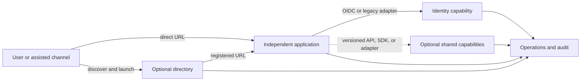

# Reference Architecture: Federated Application Portal

**Status:** Proposed | **Date:** 2026-07-11 | **Review:** 2027-07-11

This reference architecture is an informative composition of capabilities and
ADRs. It does not require every service to adopt a portal, SDK, inbox,
notification service, or native shell.

## Applicability and Non-Goals

Use this pattern when independently owned applications need one or more shared
entry, identity, account, messaging, or cross-channel capabilities across WA
agencies, cloud providers, or legacy estates. It is useful where applications
must retain independent ownership and release cycles while presenting a
coherent user journey.

This pattern is not intended to:

- Merge unrelated applications into one frontend runtime or data store
- Make a portal landing page or native application the only route to a service
- Require JavaScript, a shared SDK, inbox, notifications, personalised app
  cards, PWA features, or a native shell
- Centralise business authorisation, case management, records ownership, or
  application delivery
- Replace agency identity, privacy, information-sharing, records, procurement,
  accessibility, security, or continuity decisions

Static public services, a single application with no useful shared capability,
and machine-to-machine integration normally need simpler patterns.

## Assumptions and Prerequisites

Before selecting a variant, establish:

- Accountable service and information owners for each application and each
  shared capability
- User groups, critical journeys, assisted-digital and non-digital channels,
  and direct application URLs
- Identity populations, required assurance, recovery and fallback, and the
  attributes each application is authorised to receive
- Information classification, privacy impact, records and retention duties,
  sharing authority, consent model, processing locations, and offshoring
  assessment
- Service criticality, availability dependencies, support coverage, recovery
  time objective (RTO), recovery point objective (RPO), and acceptable degraded
  modes
- Current browser, non-JavaScript, legacy, mobile, integration, and network
  constraints
- Funding, operating capacity, onboarding demand, and an exit owner for shared
  services

Use OIDC for new interactive federation in accordance with [ADR 013: Identity
Federation Standards](../security/013-identity-federation.md). A legacy
application may use a broker, reverse-proxy integration, SAML where OIDC is
unavailable, or a documented direct sign-in path rather than a disruptive
rewrite.

## Selectable Capabilities

Select only capabilities with a user or operational need and an accountable
owner.

| Capability | Purpose | Required fallback or boundary |
|------------|---------|-------------------------------|
| Directory or portal | Discover and launch approved applications | Stable direct URL, meaningful no-JavaScript navigation, and outage communication |
| Identity and account handoff | Sign in and reach central account functions | App-owned authorisation; critical-service authentication fallback where required |
| Shared SDK or UI components | Reduce repeated integration work | Versioned documented APIs or protocol integration; SDK must not be the only path |
| Inbox | Present durable messages or tasks | Source application remains authoritative; define retention, deletion, and direct access |
| Notifications | Deliver email, SMS, push, or other alerts | Preferences, delivery status, accessible message content, and an alternative for unavailable channels |
| Native shell or webview bridge | Package selected web journeys or native functions | Direct browser path; allow-listed, versioned, origin-bound bridge messages |
| Personalised directory state | Show status or recommended actions | Explicit sharing authority, minimised data, freshness semantics, and non-personalised fallback |

The portal, SDK, inbox, notification service, and native shell are separate
capabilities. Selecting one does not imply selection of the others.

## Assurance Variants

### Minimum: Directory and OIDC

Use for low-complexity federation where discovery and common sign-in provide
enough value:

- Register accessible metadata, owner, support contact, direct launch URL, and
  OIDC client
- Launch the standalone application; the application starts and validates its
  own OIDC flow and makes its own authorisation decisions
- Provide server-rendered or progressively enhanced directory navigation that
  remains useful without JavaScript
- Do not exchange application status, inbox, or notification data unless later
  approved under a separate contract

### Standard: Shared SDK or Services

Add only the capabilities justified by common journeys:

- Offer a maintained SDK, web component, or server-side library for selected
  account, inbox, notification, telemetry, or handoff functions
- Publish the underlying protocols and APIs so legacy and non-JavaScript
  applications can integrate without the SDK
- Version schemas, SDKs, native bridges, and UI components; publish a support
  matrix, deprecation window, test fixtures, and upgrade path
- Keep shared UI peripheral to app-owned content and compatible with the
  applicable agency design system

### Higher-Assurance

Use where sensitive information, high-impact transactions, cross-agency
sharing, or critical services increase consequence:

- Isolate shared capabilities and administration according to trust,
  classification, and ownership; require step-up authentication for defined
  actions
- Use stronger service and workload identity, explicit audience restrictions,
  transaction-level authorisation, protected audit trails, and monitored
  anomaly controls
- Minimise or avoid central aggregation; use purpose-specific claims or
  references and short retention where central data is justified
- Test direct access, identity fallback, central outage, regional or site
  recovery, key rollover, consent withdrawal, and security incident procedures
- Establish independent assurance, change approval, out-of-hours escalation,
  and continuity arrangements proportionate to criticality

Higher assurance strengthens selected capabilities; it does not make every
optional capability necessary.

## Provider-Neutral Capability Architecture

Keep the directory, identity, optional shared services, application runtime,
and operational plane independently replaceable where practical. Authorise
network and data flows explicitly; a shared user identity does not grant
cross-application data access.

## Deployment Options

These are official service examples, not product selections or equivalent
one-for-one mappings.

| Capability | AWS examples | Azure examples | Google Cloud examples | Legacy or on-premises examples |
|------------|--------------|----------------|-----------------------|-------------------------------|
| Web delivery and edge | Amazon CloudFront, AWS WAF, Application Load Balancer | Azure Front Door, Web Application Firewall, Application Gateway | Cloud CDN, Cloud Armor, external Application Load Balancer | Supported reverse proxy, load balancer, WAF, and web server |
| Runtime | AWS Lambda, AWS App Runner, Amazon ECS or EKS | Azure Functions, App Service, Container Apps or AKS | Cloud Run, App Engine, GKE or Compute Engine | Supported virtual machines, application servers, containers, or existing web platforms |
| Identity | Amazon Cognito or federation to an approved identity provider | Microsoft Entra External ID or federation to an approved identity provider | Identity Platform or federation to an approved identity provider | Existing OIDC provider, identity broker, or SAML adapter where OIDC is unavailable |
| Messaging | Amazon SES, SNS or AWS End User Messaging | Azure Communication Services or Notification Hubs | Pub/Sub with approved email, SMS, or push delivery services | Agency mail or SMS gateway, message broker, and supported adapters |
| Persistence | DynamoDB, RDS or S3 according to access need | Cosmos DB, Azure SQL or Blob Storage | Firestore, Cloud SQL or Cloud Storage | Supported relational database, directory, file, or object service |

Products differ in identity semantics, regional availability, accessibility,
delivery guarantees, data location, operational model, quotas, portability,
and cost. Validate the selected composition against required capabilities;
do not infer equivalence from a row. Prefer OpenTofu or Terraform for
infrastructure provisioning under [ADR 010: Infrastructure and Configuration
as Code](../operations/010-configmgmt.md). Provider-native frameworks are
exception or bootstrap options under that ADR. Legacy configuration may also
need versioned configuration-management and image-building tools.

## Kickoff Artifacts

Create and approve these artifacts before production onboarding:

- Service brief with applicability decision, selected variant and
  capabilities, user groups, critical journeys, exclusions, and success
  measures
- Capability and dependency map with direct-access paths, trust boundaries,
  system and information owners, RTO, RPO, and degraded modes
- Governance charter covering decision rights, RACI, funding or chargeback,
  product ownership, operational ownership, support hours, and dispute and
  exception handling
- Onboarding contract covering eligibility, metadata, identity claims,
  redirect and logout behaviour, scopes, data flows, SLOs, support,
  compatibility, security evidence, launch approval, and costs
- Information schedule covering classification, purpose, sharing authority,
  consent and withdrawal, notices, minimisation, retention, deletion, export,
  processing locations, offshoring, breach handling, and records duties
- Interface pack with OIDC registration, API or event contracts, SDK and native
  bridge versions if selected, accessibility expectations, test fixtures, and
  deprecation policy
- Operational pack with service-level objectives (SLOs), monitoring, alerts,
  runbooks, contact and escalation paths, capacity assumptions, recovery plans,
  and incident exercises
- Lifecycle plan for onboarding, suspension, offboarding, data deletion and
  export, credential revocation, domain or deep-link changes, and platform
  replacement

## Roles and Operating Model

Tailor the RACI to agency arrangements, but assign each accountability once.

| Role | Accountabilities |
|------|------------------|
| Sponsoring governance body | Portfolio scope, cross-agency authority, funding model, risk acceptance, prioritisation, and unresolved disputes |
| Shared capability product owner | Roadmap, SLOs, onboarding policy, compatibility, suppliers, funding forecast, and replacement plan |
| Shared capability operator | Availability, security operations, releases, capacity, incidents, runbooks, recovery, support, and status communication |
| Federated application owner | App UX, accessibility, business authorisation, data and records, direct access, integration, support, and offboarding |
| Identity owner | Federation policy, assurance, claims, keys, recovery, lifecycle, and authentication incident response |
| Information or privacy owner | Classification, purpose and sharing authority, consent where applicable, privacy assessment, retention, disposal, location, and offshoring approval |
| Security and assurance | Threat and exposure review, control assurance, testing, exceptions, and incident coordination |
| Service desk or assisted channel | User support, identity and service triage, accessible alternatives, escalation, and known-outage guidance |

The governance body should review SLO performance, onboarding demand, shared
risk, unresolved compatibility issues, cost allocation, and capability
retirement on an agreed cadence. Cross-agency operation needs named delegations
and agreements; technical integration alone does not create authority to share
information or operate another agency's service.

## Information, Privacy, and Sharing

- Classify portal metadata, identity claims, inbox content, notification
  payloads, usage telemetry, support records, and audit logs before selecting
  storage or suppliers
- Document lawful purpose and authority for every cross-agency disclosure;
  distinguish consent from other sharing authority and do not request consent
  where it is not the applicable basis
- Make consent specific, informed, recorded, reviewable, and withdrawable where
  consent is used; define downstream action after withdrawal
- Avoid a global cross-service identifier or central activity profile unless a
  documented purpose and authority require it
- Put sensitive detail behind authenticated access rather than in email, SMS,
  push previews, URLs, analytics, or portal card metadata
- Assess all storage, support, telemetry, backup, content delivery, and supplier
  processing locations under WA information-classification, privacy, records,
  procurement, and data-offshoring requirements
- Define data subject access, correction, complaint, breach, legal hold,
  retention, deletion, and machine-readable export procedures

## Accessibility and Channel Support

Follow the applicable agency design system and [ADR 020: Frontend UI
Foundations](../development/020-frontend-ui-foundations.md).

Meet WCAG 2.2 AA for user-facing web interfaces and test representative portal,
app launch, sign-in, account, consent, inbox, notification-preference, error,
and outage states with keyboard and assistive technologies. Use semantic HTML
and progressive enhancement. Critical discovery, launch, sign-in, and support
paths must remain usable without client-side JavaScript where the supported
audience or legacy estate requires it.

An accessible journey is concise: a user discovers an application in an
accessible directory or follows its direct URL, reviews the service and privacy
information, signs in only if needed, completes the task in the independently
owned application, and receives status through an available channel. Focus and
context remain clear at redirects and handoffs. Provide assisted-digital,
telephone, in-person, or other alternatives where digital exclusion or service
policy requires them. A native shell or push notification cannot be the only
way to complete a critical task.

## Compatibility and Integration

- Publish supported browsers, identity providers, protocol and API versions,
  SDK versions, native-shell versions, and legacy adapters with end-of-support
  dates
- Use OIDC Authorization Code flow with PKCE for browser and native public
  clients; never place client secrets in browser or PWA code
- Test issuer, audience, state, nonce, redirect URI, session expiry, logout,
  signing-key rollover, account recovery, and step-up behaviour
- Keep application sessions and authorisation app-owned. Do not rely on silent
  authentication where browser privacy controls make it unreliable
- Keep documented APIs or protocol flows available when an SDK is offered;
  provide server-side and non-JavaScript paths where needed
- Version and allow-list native bridge messages, bind them to approved origins,
  validate payloads, record security-relevant use, and fail closed
- Define schema compatibility, idempotency, duplicate handling, ordering,
  freshness, retry, and dead-letter behaviour for messages and notifications

## Resilience and Recovery

Set measurable SLOs for each selected shared capability, including availability,
latency, support and incident response, notification acceptance or delivery
where measurable, and recovery. Do not publish one aggregate SLO that hides a
weaker critical dependency.

- Keep direct application URLs documented, monitored, and tested independently
  of the portal and native shell
- Define behaviour when the directory, identity provider, SDK asset host,
  inbox, notification service, network link, or native bridge is unavailable
- Avoid runtime loading of an SDK from a central origin when its outage would
  prevent the application's core journey; package or degrade safely instead
- Queue and reconcile asynchronous work with bounded retries and visible status;
  never imply notification delivery proves that a user received or acted on it
- Back up and restore authoritative data, configuration, keys, consent records,
  and audit evidence according to approved RTO, RPO, retention, and location
- Test central outage and direct access, dependency timeout, regional or site
  recovery where applicable, corrupted data, credential or key recovery, and
  status communication at least annually and after material architecture
  changes

[ADR 014: Independent Backups and Recovery](../operations/014-object-backup.md)
and [ADR 018: Managed Relational Databases and Open
Lakehouses](../operations/018-database-patterns.md) apply where those capabilities
are selected.

## Onboarding, Offboarding, and Exit

Onboarding should validate ownership, authority, metadata, identity, direct
access, accessibility, compatibility, security, operations, data flows, cost,
and support before production listing. Use a sandbox and conformance tests where
shared integration is more than a launch URL and OIDC client.

Offboarding must define notice, directory removal, safe redirects, credential
and scope revocation, queue draining, notification handling, user and support
communications, retention or transfer of records, verified deletion, export,
and closure evidence. Emergency suspension needs narrower criteria and a review
path so a portal decision does not silently remove direct access to a statutory
or critical service.

Maintain a platform replacement plan with exportable directory metadata,
configuration, consent and preference records, inbox data where authoritative,
audit evidence, API contracts, and ownership mappings. Test restoration or
migration to an independent environment. Avoid provider-specific identifiers or
SDK-only business logic where they would prevent an application or shared
capability moving independently.

## Acceptance Checks

- [ ] Applicability, selected variant, selected capabilities, non-goals, owners,
      funding, RACI, and cross-agency delegations are approved
- [ ] Onboarding contract, direct URLs, identity registrations, claims, scopes,
      data flows, support contacts, compatibility matrix, and deprecation policy
      are published
- [ ] Classification, privacy, sharing authority, consent where applicable,
      records, retention, deletion, export, processing location, supplier, and
      offshoring decisions are recorded
- [ ] Portal and critical app journeys pass WCAG 2.2 AA, keyboard,
      assistive-technology, non-JavaScript where required, browser, device,
      assisted-channel, and handoff testing
- [ ] Authentication, application authorisation, account recovery, logout,
      session expiry, step-up, key rollover, and identity fallback tests pass
- [ ] API, event, SDK, component, legacy adapter, and native bridge contracts
      pass compatibility and security tests for the selected capabilities
- [ ] SLOs, dependency monitoring, capacity, alerts, support, escalation,
      incident, breach, and recovery runbooks are operational
- [ ] Central outage and direct-access tests show that each critical application
      remains reachable or has an approved continuity path
- [ ] Backup and recovery tests meet approved RTO and RPO, including
      configuration, keys, records, and authoritative data
- [ ] Onboarding, suspension, offboarding, credential revocation, deletion,
      export, and platform replacement have named owners and tested procedures
- [ ] Infrastructure and supported configuration are reproducible using
      OpenTofu or Terraform as preferred by ADR 010, with justified exceptions

## Related Decisions

Accepted dependencies:

- [ADR 001: Application Isolation](../security/001-isolation.md)
- [ADR 003: HTTP API Contract Standards](../development/003-apis.md)
- [ADR 004: CI/CD Standards](../development/004-cicd.md)
- [ADR 005: Secrets Management](../security/005-secrets-management.md)
- [ADR 007: Centralised Security Logging](../operations/007-logging.md)
- [ADR 009: Release Standards](../development/009-release.md)
- [ADR 010: Infrastructure and Configuration as Code](../operations/010-configmgmt.md)
- [ADR 013: Identity Federation Standards](../security/013-identity-federation.md)
- [ADR 016: Web Application Edge Protection](../security/016-edge-protection.md)
- [ADR 014: Independent Backups and Recovery](../operations/014-object-backup.md)
- [ADR 015: Data Pipeline Contracts, Quality and Lineage](../operations/015-data-governance.md)
- [ADR 018: Managed Relational Databases and Open Lakehouses](../operations/018-database-patterns.md)
- [ADR 020: Frontend UI Foundations](../development/020-frontend-ui-foundations.md)

Proposed dependencies and examples to assess rather than treat as mandates:

- [ADR 021: Workload mTLS and Service Authorisation](../security/021-workload-mtls.md),
  when shared services run on Kubernetes
- [Identity Federation](identity-management.md)
- [OpenAPI Backend](openapi-backends.md)
