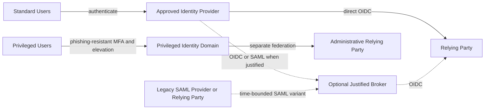

# Reference Architecture: Identity Federation

**Status:** Proposed | **Date:** 2026-07-11 | **Review:** 2027-07-11

## Applicability and Non-Goals

Use this reference architecture when a WA agency application or service must
trust an external workforce, citizen, customer, partner, or privileged-user
identity provider. It covers:

- Direct OpenID Connect (OIDC) federation for a relying party
- A broker where multiple upstream providers, protocol translation, migration,
  or common policy provides a documented benefit
- A separate privileged-user federation path
- Time-bounded SAML federation for a legacy provider or relying party that
  cannot support OIDC

This is identity federation architecture, not a complete identity and access
management (IAM) architecture. Identity proofing, registration, joiner-mover-
leaver lifecycle, authoritative directory design, entitlement governance,
workload identity, fine-grained application authorisation, and fraud operations
are non-goals. The owning agency must design those capabilities separately.
Federation conveys identity and authentication context; it does not prove that
an account lifecycle or application entitlement is appropriate.

Do not use this pattern to create a new identity provider by default or to add a
broker where one approved provider can federate directly with the relying
party.

## How to Use This Reference Architecture

This reference architecture composes ADRs and does not establish a new identity
standard. Apply requirements from Accepted ADRs. A Proposed ADR remains a
dependency under consideration, not an accepted standard; obtain project
approval or document an approved alternative before relying on it.

| Dependency | Status | Application in this pattern |
|---|---|---|
| [ADR 001: Application Isolation](../security/001-isolation.md) | Accepted | Separation of standard, privileged, administrative, and environment trust boundaries |
| [ADR 004: CI/CD Quality Assurance](../development/004-cicd.md) | Accepted | Federation adapters, policy, tests, and released artifacts |
| [ADR 005: Secrets Management](../security/005-secrets-management.md) | Accepted | Client secrets, certificates, API credentials, and rotation |
| [ADR 007: Centralised Security Logging](../operations/007-logging.md) | Accepted | Authentication, recovery, policy, and administrative events |
| [ADR 009: Release Standards](../development/009-release.md) | Accepted | Controlled claim, policy, client, metadata, and application changes |
| [ADR 010: Infrastructure and Configuration as Code](../operations/010-configmgmt.md) | Accepted | OpenTofu or Terraform provisioning and controlled platform configuration |
| [ADR 012: Privileged Remote Access](../security/012-privileged-remote-access.md) | Accepted | Separate privileged identities, phishing-resistant MFA, JIT, and break-glass controls |
| [ADR 013: Identity Federation Standards](../security/013-identity-federation.md) | Accepted | OIDC-first protocol, SAML fallback, MFA, broker justification, fallback, and evidence |
| [ADR 014: Independent Backups and Recovery](../operations/014-object-backup.md) | Accepted | Independent recovery of configuration, audit evidence, keys or procedures, and account data where applicable |
| [ADR 021: Workload mTLS and Service Authorisation](../security/021-workload-mtls.md) | **Proposed, conditional dependency** | Identity-based mTLS and service policy when agency-managed federation components run on Kubernetes |

Agency privacy, information-classification, accessibility, records,
procurement, Digital ID, and offshoring obligations still apply where no ADR
defines them.

## Assumptions and Prerequisites

Before product selection or relying-party integration, confirm:

- An approved upstream identity authority owns proofing, enrolment, lifecycle,
  compromise response, and authentication appropriate to the user population.
- The relying service has a named business owner, relying-party owner, identity
  provider owner, security owner, privacy owner, service desk, and application
  support team.
- The service has documented user populations, transaction risks, information
  classification, required authentication assurance, accessibility needs,
  support hours, and approved RTO and RPO.
- The relying party can validate OIDC tokens and keep authorisation decisions
  local unless a separate accepted decision establishes central entitlement
  policy.
- Required domains, redirect paths, private administrative access, trusted
  time, DNS, certificates, key management, logs, and provider support are
  available.
- Account and MFA recovery can re-establish the required assurance without an
  unmonitored bypass and without excluding users who cannot use one method.
- Each requested claim has an owner, definition, source, purpose, lawful basis,
  classification, release rule, retention expectation, and consumer.

If the upstream provider cannot supply the required assurance or claims, do not
silently manufacture assurance in a broker. Change the service design, add an
approved proofing or verification capability, or record the risk decision.

## Architecture and Capability Model

The dotted paths are optional variants, not required hops. Keep these logical
capabilities identifiable even where one managed platform combines them:

| Capability | Provider-neutral responsibility |
|---|---|
| Identity authority | Authenticates a defined population and supplies documented assurance and lifecycle signals |
| Trust and protocol endpoint | OIDC discovery, authorisation, token, user-info, logout, or SAML metadata and endpoints as applicable |
| Relying-party registration | Exact clients, redirect URIs, scopes, keys, owners, environments, and review dates |
| Claims mediation | Allow-listed release, mapping, provenance, assurance preservation, minimisation, and versioning |
| Token and session control | Secure flow, validation, audience, nonce and state, lifetime, revocation response, logout, and reauthentication |
| MFA and recovery | Risk-appropriate authenticators, enrolment, reset, assisted recovery, fraud checks, and accessible alternatives |
| Key and metadata operations | Protected keys, publication, caching, overlap, rollover, revocation, and emergency procedures |
| Federation administration | Isolated privileged access, approvals, configuration audit, drift detection, and break-glass |
| Observability and support | Privacy-aware events, health, synthetic tests, alerting, incident handling, user support, and provider escalation |
| Migration and exit | Configuration and user export, subject mapping, claim compatibility, parallel operation, rollback, and decommissioning |

## Architecture Variants

### Minimum Direct OIDC Variant

Use this default shape for a new relying party and one approved identity
provider when direct federation meets assurance, privacy, availability, and
support requirements.

- Integrate the relying party directly with the provider using OIDC
  Authorization Code flow with PKCE and the validation controls in ADR 013.
- Register separate clients and exact redirect URIs for environments and trust
  boundaries. Keep privileged administration on its separate path.
- Request only approved scopes and claims. Translate the provider subject into
  an application-owned internal identifier so provider details do not become
  business keys throughout the application.
- Keep application roles and transaction authorisation in the application or
  a separately approved authorisation service. Do not infer entitlement from
  successful login alone.
- Implement risk-appropriate MFA, recovery, logging, key rollover, fallback,
  provider escalation, and tested export before production acceptance.

This is a minimum component count, not reduced authentication assurance.

### Higher-Assurance OIDC Variant

Use for privileged access, high-impact transactions, sensitive information, or
critical services where the risk assessment requires stronger controls.

- Require phishing-resistant authentication where supported and step-up or
  fresh authentication before high-risk transactions.
- Use separate privileged identities, provider policy, clients, administrative
  endpoints, and application paths under ADRs 001, 012, and 013.
- Bind the relying-party decision to required authentication context and age;
  reject missing, stale, or unrecognised assurance claims rather than assuming
  a default.
- Add transaction or out-of-band verification where a separate risk decision
  requires it; federation alone does not authorise a high-risk action.
- Test provider, DNS, key, metadata, network, support, recovery, and regional
  failure modes against approved service objectives.
- Protect federation configuration, mapping data, audit evidence, and any local
  account store with stronger administrative separation and recovery controls.

### Justified Broker Variant

Add a broker only when the selection record demonstrates one or more of these
needs: several upstream providers, SAML-to-OIDC translation, consistent
claim-release policy, controlled provider migration, or shielding many relying
parties from unavoidable upstream differences.

- Record why direct OIDC is insufficient and compare the broker's concentration
  risk, latency, outage impact, support burden, privacy exposure, cost, and exit
  path with direct integrations.
- Prefer an OIDC interface from broker to modern relying parties. Preserve the
  original issuer, subject mapping, claim provenance, and authentication
  assurance needed for audit without over-sharing them to applications.
- Do not let the broker invent identity proofing or MFA assurance, collapse
  standard and privileged populations, or become the default source of
  application entitlements.
- Isolate and monitor the broker as a critical security dependency. Test
  bypass, fail-closed behaviour, key rollover, configuration recovery, and
  migration away from it.

### Privileged Federation Variant

Use a separate privileged identity domain and relying-party registration for
administrative functions. Apply ADR 012 for dedicated identities,
phishing-resistant MFA, just-in-time elevation, approval, expiry, session
evidence, and monitored break-glass. Do not expose privileged claims through a
standard-user client or allow a standard session to become privileged solely
through an application role change.

### Legacy SAML Variant

Use SAML 2.0 only where an upstream provider or legacy relying party cannot
support OIDC, as allowed by ADR 013.

- Record the incompatible component, owner, support status, compensating
  controls, target OIDC architecture, migration milestone, and review date.
- Validate signed assertions and required responses, issuer, audience,
  destination, recipient, time conditions, request correlation, and replay
  controls. Restrict accepted bindings, algorithms, certificates, attributes,
  and endpoints.
- Prefer protocol translation at one supported gateway or broker over adding
  SAML logic to multiple new applications, but justify that broker under the
  preceding variant.
- Monitor metadata and certificate expiry and test overlapping certificate
  rollover. Keep rollback metadata available for the approved window.
- Do not expose LDAP binds or an Active Directory domain directly to an
  Internet-facing application as a substitute for federation.

## Claims, Assurance, and Session Design

Maintain a versioned claims matrix for every relying party. It must distinguish
required from optional claims and record source, definition, format, assurance,
transformation, release condition, classification, purpose, retention, and
fallback behaviour.

- Use the tuple of trusted issuer and immutable provider subject for federation
  correlation, mapped to an application-owned identifier. Do not use mutable
  email address, display name, or phone number as the durable subject key.
- Keep workforce, citizen or customer, partner, privileged, and workload
  identities in separate policies and trust decisions. This architecture does
  not cover workload federation.
- Preserve unknown, missing, conflicting, and low-assurance claim states. Do
  not convert them into a favourable default.
- Define token and session lifetime from transaction risk, revocation needs,
  user experience, provider capability, and outage behaviour. Test logout and
  reauthentication but do not claim universal logout where dependencies cannot
  provide it.
- Document which component makes identity-proofing, MFA, step-up, account
  status, and authorisation decisions and how the relying party verifies each
  signal.

## Implementation Examples

These official links are non-equivalent product examples, not standards,
endorsements, or a claim of feature parity. Some combine a user directory,
identity provider, broker, login UI, and lifecycle features; others supply only
part of the capability model. Validate current Australian-region processing,
support access, protocols, authenticators, accessibility, logging, export,
recovery, quotas, price, and service objectives.

| Estate | Non-equivalent example | Fit to evaluate |
|---|---|---|
| AWS | [Amazon Cognito user pools](https://docs.aws.amazon.com/cognito/latest/developerguide/cognito-user-pools.html) | Customer directory and app-facing OIDC provider with upstream OIDC or SAML federation; evaluate claim, MFA, export, and recovery needs |
| Azure | [Microsoft Entra External ID](https://learn.microsoft.com/en-us/entra/external-id/customers/overview-customers-ciam) | External identities and customer application federation; it is distinct from workforce Entra tenant design |
| Google Cloud | [Identity Platform](https://cloud.google.com/identity-platform/docs) | Customer authentication with OIDC and SAML provider integration; validate MFA, tenant, export, and regional requirements |
| Legacy or on-premises | [Active Directory Federation Services](https://learn.microsoft.com/en-us/windows-server/identity/ad-fs/ad-fs-overview), an approved SAML product implementing the [OASIS SAML 2.0 standard](https://docs.oasis-open.org/security/saml/v2.0/), or a supported gateway to [LDAP-based directories](https://learn.microsoft.com/en-us/windows/win32/adsi/ldap-adspath) | Existing workforce directory or legacy federation only; AD or LDAP is not equivalent to a managed customer identity platform and normally needs a federation service or gateway |

Provision supported tenants, pools, projects, clients, domains, policies,
logging, keys, and networking with [OpenTofu](https://opentofu.org/docs/) or
[Terraform](https://developer.hashicorp.com/terraform/docs) under ADR 010.
Where a provider API cannot manage required identity configuration, record the
ADR 010 exception and preserve equivalent review, export, drift detection,
audit, and recovery evidence.

## Project Kickoff Artifacts

Create these artifacts before implementation selection is final:

- A service context and trust-boundary diagram covering user populations,
  identity authorities, federation hops, standard and privileged paths,
  environments, regions, and administrative access
- A relying-party register with owner, purpose, population, URLs, protocol,
  issuer, client or entity ID, redirect and logout URIs, scopes, claims,
  assurance, MFA, session, fallback, support, criticality, and review date
- A claims and assurance matrix with privacy, classification, source,
  transformation, release, missing-value, and authorisation handling
- A provider and direct-versus-broker selection record comparing assurance,
  privacy, accessibility, resilience, support, integration, export, cost, and
  concentration risk
- User journeys for login, consent or notice, MFA enrolment, step-up, logout,
  account linking, recovery, denied access, provider outage, and assisted
  support, including accessibility findings
- A threat model covering token theft, login CSRF, redirect abuse, account
  linking, subject collision, claim injection, replay, recovery fraud,
  enumeration, key compromise, broker compromise, and privileged crossover
- A support RACI naming the relying-party, provider, platform, security, fraud,
  privacy, service-desk, communications, and supplier escalation owners
- RTO and RPO, dependency and failure analysis, key-rollover plan, fallback and
  failover runbook, provider status and escalation details, and recovery test
  schedule
- An OpenTofu or Terraform repository and state design, configuration export,
  CI/CD and release plan, secrets and certificate inventory, and ADR 010
  exception records where needed
- A subject and claim migration plan, provider export test, dual-operation and
  rollback plan, retention and disposal decision, and exit cost estimate

## Privacy, Classification, and Offshoring

Apply the [WA Information Classification
Policy](https://www.wa.gov.au/government/document-collections/western-australian-information-classification-policy),
[Privacy and Responsible Information
Sharing](https://www.wa.gov.au/government/privacy-and-responsible-information-sharing),
and [WA Data Offshoring
Governance](https://www.wa.gov.au/system/files/2025-06/dataoffshoringgovernancewithwadataoffshoringposition.pdf)
as applicable. Record agency approvals and controls rather than treating a
vendor compliance statement or selected region as approval.

- Classify identity attributes, credentials, MFA methods, recovery data,
  device and risk signals, subject mappings, authentication logs, support
  records, configuration exports, and backups.
- Request and release only the claims needed for the relying party's approved
  purpose. Prefer service-specific or pairwise identifiers where supported and
  avoid persistent cross-service correlation without documented authority.
- Record notice, consent where applicable, access, correction, retention,
  disposal, breach, fraud, and disclosure handling across provider, broker,
  relying party, logs, and support systems.
- Assess primary processing, control plane, telemetry, messaging, support
  access, subprocessors, backups, and disaster recovery for offshore handling.
  Include identity metadata and vendor support, not only profile attributes.
- Prevent identity and authentication data being reused for unrelated analytics
  or marketing without separate authority. Minimise security logs while
  retaining the events required by ADRs 007 and 013.

Assess the [Digital ID Act
2024](https://www.legislation.gov.au/C2024A00025/latest/text) and associated
rules only when the service participates in their scope, as ADR 013 requires.
Do not represent ordinary OIDC federation as accredited identity proofing.

## MFA, Recovery, and Login Accessibility

- Apply ADR 013 MFA requirements by population, information sensitivity, and
  service risk. For privileged access, apply ADR 012 and prefer
  phishing-resistant authenticators. SMS or voice is not the target state.
- Design enrolment, replacement, lost-device, compromised-account, and assisted
  recovery. Verify recovery to an assurance appropriate to the resulting
  access, notify the user, rate-limit attempts, and log administrative action.
- Provide accessible alternatives for users who cannot use a particular
  authenticator, device, CAPTCHA, or recovery channel without creating an
  unmonitored bypass.
- Test the complete login, redirect, consent or notice, error, MFA, timeout,
  recovery, and logout journey against [WCAG
  2.2](https://www.w3.org/TR/WCAG22/) and applicable WA digital-service
  requirements. Include keyboard-only, screen reader, zoom and reflow, colour
  contrast, cognitive load, plain-language error, and mobile testing.
- Make the service desk path discoverable when the provider is unavailable or
  the user is locked out. Support staff must not be able to bypass proofing,
  MFA, or audit controls for convenience.

## Ownership and Operations

The kickoff RACI must assign named teams, delegates, support coverage, and
supplier escalations. At minimum it must allocate these outcomes:

| Role | Accountable operational outcomes |
|---|---|
| Service owner | Population, risk, funding, service objectives, user outcomes, and acceptance |
| Relying-party owner | Client configuration, token validation, sessions, local mapping, authorisation, releases, and rollback |
| Identity-provider owner | Authentication policy, lifecycle signals, MFA, recovery, availability, keys, metadata, and provider incidents |
| Broker or platform owner | Claim mediation, upstream and downstream trust, runtime, capacity, configuration, and recovery where a broker exists |
| Security and fraud owners | Assurance, monitoring, threat response, compromised identities, and high-risk recovery |
| Privacy and information owners | Claim purpose, classification, notice, sharing, retention, location, offshoring, and rights handling |
| Service desk and communications | Accessible user support, verified recovery hand-off, outage messaging, and escalation |

Monitor login success and failure by journey, MFA and recovery outcomes, token
validation errors, unknown issuers or keys, metadata age, certificate expiry,
provider latency, broker health, claim-mapping failures, privileged elevation,
configuration changes, suspicious linking, support demand, and synthetic login
tests. Set privacy-preserving thresholds and named response actions; avoid
placing tokens or unnecessary claims in logs.

## Resilience, Key Rollover, and Recovery

- Set RTO and RPO for login, federation configuration, subject mappings, local
  account data, audit evidence, and administrative recovery. Include DNS,
  network, messaging, MFA, secrets, certificates, key services, and supplier
  support dependencies.
- Consume OIDC discovery and JSON Web Key Sets only from configured trusted
  issuers. Cache safely for bounded outages, refresh on an unknown key ID, and
  fail closed for an untrusted issuer, invalid signature, or unacceptable
  token. Do not dynamically trust an alternate issuer.
- Test planned signing-key rollover with overlapping keys, cache refresh, old
  token validation, emergency revocation, rollback, monitoring, and provider-
  relying-party coordination. For SAML, test equivalent metadata and
  certificate rollover before expiry.
- Define critical-service fallback under ADR 013. A fallback may use a tested
  alternate approved provider, constrained offline process, or monitored
  break-glass path, but must preserve appropriate assurance and authorisation,
  be time-bound, and produce audit evidence.
- Treat failover to a second provider as a separate trust and subject-mapping
  design. Pre-register and test it; define how issuer, subject, claims, MFA,
  sessions, account linking, and rollback behave. DNS switching alone is not
  identity failover.
- Under ADR 014, keep independent and
  tested recovery material for configuration, infrastructure state, client and
  claim registers, mapping data, audit evidence, and keys or key-recovery
  procedures. Replication and provider availability are not backups by
  themselves.

## Migration and Exit

Test export before selecting a provider. Document supported exports and APIs
for users where lawfully held, immutable identifiers, attributes, group or
policy assignments where in scope, clients, redirect URIs, identity providers,
claims rules, branding, templates, logs, consent or notice evidence, and
configuration. Record credentials and MFA methods that cannot be exported and
the user re-enrolment impact.

1. Create a protected mapping from old trusted issuer and subject to the
   application-owned identity and the new provider subject. Never join accounts
   automatically on mutable email alone.
2. Map claim names, values, provenance, assurance, missing states, and local
   authorisation effects. Test representative and adverse identities.
3. Run old and new federation in parallel for controlled cohorts or a defined
   dual-login window. Monitor login, linking, MFA, recovery, support, and
   authorisation outcomes without creating duplicate accounts.
4. Define cutover authority, user communications, session invalidation,
   rollback triggers, old-provider availability, mapping rollback, and the
   maximum rollback window. Exercise rollback before broad migration.
5. Retain the old configuration, mappings, logs, and recovery path until
   acceptance and rollback periods end. Then revoke trust, clients, keys,
   administrative access, and supplier access and dispose of data under
   approved authority.

## Verifiable Credentials Roadmap

Verifiable credentials are roadmap only, not a current federation variant or
requirement. Monitor [W3C Verifiable Credentials Data Model
2.0](https://www.w3.org/TR/vc-data-model-2.0/),
[OpenID for Verifiable Credentials](https://openid.net/openid4vc/), and
[ISO/IEC 18013-5](https://www.iso.org/standard/69084.html). Adopt only through a
separate approved decision with a specific use case and evidence for trust
framework, issuer and verifier governance, selective disclosure, consent,
revocation or status, device binding, recovery, accessibility, interoperability,
privacy, support, and fallback. Do not delay a suitable OIDC federation waiting
for this roadmap.

## Acceptance Checks

- [ ] The scope is federation; lifecycle, proofing, entitlement, workload
  identity, and fine-grained authorisation owners and non-goals are explicit
- [ ] Accepted ADR requirements, including ADR 014 recovery controls, are
  implemented
- [ ] Every relying party is in the register with owner, protocol, issuer,
  clients, URLs, claims, assurance, MFA, session, fallback, support, and review
- [ ] Direct OIDC is used for new integrations unless the broker or SAML variant
  has an approved, evidenced justification and migration boundary
- [ ] Standard and privileged identities, clients, paths, administration, and
  policies are separated and tested
- [ ] Claims and assurance mappings are versioned, minimised, privacy-approved,
  and tested for missing, conflicting, stale, and low-assurance values
- [ ] Classification, privacy, retention, supplier, location, and offshoring
  assessments cover profiles, mappings, logs, support, telemetry, and backups
- [ ] MFA enrolment, step-up, lost-device, compromise, assisted recovery, and
  accessible alternative journeys pass security and user testing
- [ ] Complete login and recovery journeys pass applicable WCAG 2.2 testing on
  representative browsers, devices, and assistive technologies
- [ ] Token or assertion validation, redirect restrictions, sessions, logout,
  account linking, enumeration, replay, and fail-closed behaviour pass tests
- [ ] Planned and emergency key or certificate rollover, metadata caching,
  expiry alerts, fallback, failover, and rollback meet approved service targets
- [ ] The support RACI, monitoring, synthetic tests, runbooks, provider contacts,
  user communications, and incident exercises are operational
- [ ] OpenTofu or Terraform plans, state controls, configuration exports, drift
  detection, and recovery evidence meet ADR 010
- [ ] Subject and claim migration, provider export, controlled parallel login,
  rollback, trust revocation, retention, and decommissioning are tested
- [ ] Verifiable credentials remain roadmap-only unless a separate approved
  decision establishes the use case and controls
