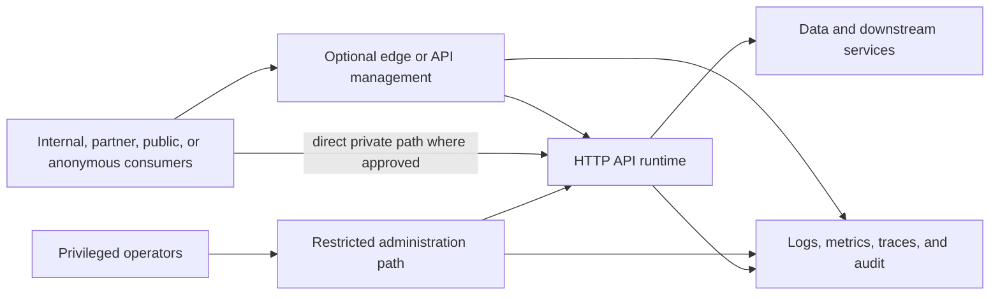

# Reference Architecture: OpenAPI Backend

**Status:** Accepted | **Date:** 2026-07-11 | **Review:** 2027-07-11

This reference architecture is an informative composition for HTTP APIs. It
does not mandate an API gateway, cloud provider, runtime, database, container
platform, public exposure, or separate administration endpoint for every API.

## Applicability and Non-Goals

Use this pattern for an agency-controlled HTTP API whose requests, responses,
parameters, authentication schemes, and material errors can be accurately
described by OpenAPI. It supports internal, partner, public, and administrative
APIs across cloud and legacy environments.

Use the protocol-native contract for GraphQL, gRPC, AsyncAPI-compatible events,
message queues, file transfer, database interfaces, webhooks that need an event
contract beyond OpenAPI, and other non-HTTP or event-driven protocols. OpenAPI
may document an HTTP ingress or callback without becoming the contract for the
underlying protocol.

This pattern does not:

- Require REST, synchronous integration, JSON, authentication for deliberately
  anonymous public information, or Internet publication
- Turn an inaccurate generated specification into the source of truth
- Require standard and administrative operations to use separate products when
  equivalent risk-based isolation can be demonstrated
- Replace domain, security, privacy, records, accessibility, supplier,
  continuity, or data-sharing decisions
- Require replacement of a stable legacy API solely to adopt a new framework
- Apply to third-party APIs the agency cannot change, although consumers should
  pin, monitor, and test the contract they depend on

## Assumptions and Prerequisites

Before selecting a variant, identify:

- Accountable API product, business, technical, information, security, and
  operational owners
- Named consumer groups, use cases, expected demand, support needs, and
  dependency criticality; do not design only for an unknown generic consumer
- Exposure and threat model, trust boundaries, administrative functions,
  abuse cases, and consequence of unauthorised access or service exhaustion
- Information classification, privacy impact, records and retention duties,
  sharing authority, processing locations, suppliers, and offshoring assessment
- Authentication and workload identity, resource and operation authorisation,
  anonymous operations, and privileged-access requirements
- Availability target, latency and throughput objectives, quotas, payload
  limits, RTO, RPO, consistency, idempotency, and degraded or failover behaviour
- Existing protocols, data stores, runtime constraints, network paths, and
  consumer migration windows

Prefer an existing authoritative protocol or domain standard where it meets the
need. Treat the OpenAPI document, implementation, gateway or proxy policy, and
consumer documentation as related artifacts that must be tested for drift.

## Assurance Variants

### Internal API

Use for agency or approved shared-network consumers where exposure and data risk
are bounded:

- Publish a version-controlled OpenAPI contract and owner, consumer, support,
  compatibility, and SLO information in an accessible internal catalogue
- Use workload identity or authenticated user delegation where required;
  anonymous access is unusual internally but may be justified for non-sensitive
  health or discovery information
- Apply operation and resource-level authorisation, validation, quotas, logging,
  network controls, and dependency timeouts according to risk
- A gateway is optional. A maintained reverse proxy, load balancer, service
  mesh, application framework, or legacy gateway may provide required controls

### Partner or Public API

Use for cross-agency, supplier, community, or Internet consumers:

- Define consumer registration where required, terms of use, support, change
  communication, quotas, abuse handling, and public status information
- Allow anonymous access to deliberately public information where the
  classification, privacy, integrity, scraping, denial-of-service, and cost
  risks are accepted; do not add authentication without a need
- Use risk-appropriate managed edge and DDoS protection for Internet exposure
  and a WAF where HTTP threats warrant it, consistent with [ADR 016: Web
  Application Edge Protection](../security/016-edge-protection.md)
- Protect origins from edge bypass where an edge is part of the approved
  control design; apply TLS, validation, rate or resource controls, and useful
  errors without disclosing sensitive implementation detail
- Publish accessible, task-oriented documentation and machine-readable
  contracts from the same reviewed version

### Higher-Assurance Administrative API

Use for privileged control-plane, bulk, destructive, security, identity,
financial, or sensitive-data operations:

- First determine whether an API is needed; prefer controlled operational
  workflows over broad general-purpose administration surfaces
- Keep privileged operations off public networks by default. Where Internet
  access is necessary, use the approved exposure design required by [ADR 003:
  HTTP API Contract Standards](../development/003-apis.md)
- Separate standard and administrative exposure by hostname, route, gateway,
  runtime, identity realm, network path, or another combination proportionate
  to threat and consequence; document why the chosen boundaries are sufficient
- Require strong administrator identity, phishing-resistant MFA where
  practical, just-in-time and least-privilege access, operation and resource
  authorisation, protected audit, and monitored break-glass procedures
- Apply tighter quotas, change approval, dual control for selected high-impact
  operations, response redaction, and independent recovery where justified
- Test that standard identities and network paths cannot invoke administrative
  operations, including alternate routes, old versions, and direct origins

One service may combine variants at different operations. Separate edge and
administration paths when that materially reduces exposure or privilege, not as
an unsupported universal topology rule.

## Provider-Neutral Capability Architecture

Compose only the capabilities required:

| Capability | Durable responsibility |
|------------|------------------------|
| Contract and catalogue | Versioned OpenAPI, ownership, audience, examples, compatibility, deprecation, support, and discovery |
| Exposure and routing | TLS, approved network path, route and version mapping, origin protection where applicable, request limits, and failure behaviour |
| Identity and policy | Consumer or administrator authentication where needed, workload identity, operation and resource authorisation, scopes, and policy decision evidence |
| API management | Optional onboarding, credentials, quotas, analytics, transformation, monetisation where applicable, and developer portal |
| Runtime | Contract-conformant business behaviour, validation, timeouts, cancellation, concurrency, idempotency, dependency isolation, and safe errors |
| Data and integration | Classification-aware persistence, transactions, consistency, lineage, sharing rules, downstream contracts, and export |
| Operations | SLOs, telemetry, audit, alerting, support, incident response, capacity, recovery, and runbooks |

Avoid implementing business authorisation only at an edge gateway. The runtime
must enforce resource and domain rules with trusted identity context.

## Deployment Options

These official examples illustrate possible compositions. They are neither
mandates nor one-for-one equivalents.

| Capability | AWS examples | Azure examples | Google Cloud examples | Legacy or on-premises examples |
|------------|--------------|----------------|-----------------------|-------------------------------|
| API management or gateway | Amazon API Gateway | Azure API Management | Apigee or API Gateway | Supported API gateway or reverse proxy |
| Edge and load balancing | Amazon CloudFront, AWS WAF, Application Load Balancer | Azure Front Door, Web Application Firewall, Application Gateway | Cloud CDN, Cloud Armor, external Application Load Balancer | Supported WAF, load balancer, reverse proxy, and network controls |
| Managed application runtime | AWS Lambda, App Runner, Elastic Beanstalk, ECS or EKS | Azure Functions, App Service, Container Apps or AKS | Cloud Run, App Engine, GKE or Compute Engine | Supported application server, virtual machine, container platform, or mainframe adapter |
| Identity integration | IAM and Cognito federation capabilities | Microsoft Entra ID and managed identities | Cloud IAM, Identity Platform, and Workload Identity Federation | Agency identity provider, PKI, OAuth or OIDC server, or a constrained legacy adapter |
| Persistence | RDS, DynamoDB or S3 according to access need | Azure SQL, Cosmos DB or Blob Storage | Cloud SQL, Spanner, Firestore or Cloud Storage | Supported relational, document, object, file, or mainframe data service |
| Observability | CloudWatch and X-Ray | Azure Monitor and Application Insights | Cloud Logging, Monitoring and Trace | Agency monitoring, OpenTelemetry-compatible tooling, syslog or supported agents |

Products differ in gateway policy models, protocol support, identity semantics,
regional availability, network integration, transformation fidelity, quotas,
portability, observability, cost, and operating responsibility. Validate the
whole composition and do not infer equivalence from a row. A managed API
gateway does not by itself provide a runtime, complete DDoS protection, domain
authorisation, records compliance, backup, or recovery.

Prefer OpenTofu or Terraform for infrastructure provisioning under [ADR 010:
Infrastructure and Configuration as Code](../operations/010-configmgmt.md).
Provider-native frameworks are exception or bootstrap options under that ADR.
Use versioned configuration-management and image-building tools where legacy or
on-premises platforms cannot be provisioned through those providers.

## Kickoff Artifacts

Create and approve these artifacts before production exposure:

- API brief with applicability, selected variant, purpose, operations, non-goals,
  service boundaries, owners, consumers, demand, success measures, and funding
- Version-controlled OpenAPI contract with stable operation identifiers,
  schemas, examples, errors, security declarations, and a generation or review
  method that prevents implementation drift
- Consumer and dependency register with business and technical contacts,
  criticality, versions, credentials or identities, quotas, migration windows,
  and notification channels
- Threat and exposure model showing Internet, partner, internal, direct-origin,
  administrative, data-store, and downstream paths plus abuse and exhaustion
  scenarios
- Information schedule recording classification, purpose, sharing authority,
  privacy assessment, retention, deletion, export, processing locations,
  supplier access, offshoring, records duties, and logging minimisation
- Non-functional profile with availability and latency SLOs, throughput,
  concurrency, payload and quota limits, RTO, RPO, consistency, idempotency,
  timeout, retry, circuit-breaking, and failover behaviour
- Test plan covering contract, behaviour, authentication, authorisation,
  anonymous access where selected, security, performance, resilience,
  failover, compatibility, and administration-path isolation
- Operating pack with dashboards, alerts, runbooks, support and escalation,
  incident and breach procedures, certificate and credential rotation, backup
  and restore, capacity, and dependency outage procedures
- Lifecycle plan covering version support, deprecation, consumer migration,
  data export, runtime or gateway replacement, supplier exit, archival, and
  verified deletion

## Roles and Operating Model

| Role | Accountabilities |
|------|------------------|
| API product or business owner | Purpose, consumers, funding, roadmap, SLO approval, terms, prioritisation, deprecation, and risk acceptance |
| Technical owner | Contract, implementation, compatibility, architecture, test strategy, dependencies, portability, and technical debt |
| Information or privacy owner | Classification, purpose and sharing authority, privacy, records, retention, disposal, export, location, and offshoring decisions |
| Platform or gateway owner | Shared routing, policy capability, tenant onboarding, platform SLOs, capacity, upgrades, support, and replacement |
| Runtime operator | Deployment, availability, telemetry, incidents, vulnerabilities, scaling, backup, recovery, and runbooks |
| Security and identity owners | Threat and exposure review, identities, authorisation design, privileged access, assurance, monitoring, and exceptions |
| Consumer owner | Intended use, credential protection, demand forecast, compatibility testing, migration, support contact, and incident participation |

Shared platform and API SLOs must be distinguishable. Establish support hours,
on-call and escalation, maintenance communication, incident command, consumer
notification, cost allocation, and periodic access and consumer reviews.

## Contract and Documentation

- Maintain OpenAPI in version control and validate syntax, references, examples,
  operation identifiers, security declarations, and compatibility in CI
- Use contract-first or implementation-first development only if the published
  contract is reviewed and automated tests detect drift from runtime behaviour
- Describe all supported success and material error responses, pagination,
  filtering, content types, payload limits, rate-limit behaviour, correlation,
  idempotency, and retry safety
- Define compatibility and versioning around consumer impact rather than
  assuming URL versioning alone prevents breaking changes
- Publish a changelog, support policy, deprecation dates, migration guidance,
  status and support routes, and downloadable machine-readable contract
- Make developer documentation WCAG 2.2 AA: use semantic headings and tables,
  keyboard-operable navigation and consoles, text alternatives, clear errors,
  sufficient contrast, and code examples that do not rely on colour alone
- Provide static or no-JavaScript access to essential reference and onboarding
  information; an interactive API console is optional and must not be the only
  documentation
- Ensure examples use non-sensitive synthetic data and identify whether
  operations are anonymous, user-delegated, workload-authenticated, or
  administrative

## Security, Classification, and Offshoring

- Authenticate only where required, but always enforce approved operation and
  resource authorisation. Treat object-level and function-level authorisation
  as runtime responsibilities
- Validate path, query, header, and body input and validate material output
  against the contract without relying only on gateway schema validation
- Define request, response, upload, query, concurrency, execution-time, and
  downstream resource limits; rate limits alone do not prevent expensive calls
- Minimise personal or sensitive information in URLs, errors, logs, traces,
  analytics, gateway caches, developer portals, and test environments
- Classify API payloads, credentials, metadata, logs, backups, exports, and
  support access. Apply privacy, records, sharing, retention, and disposal rules
  to each copy
- Assess cloud regions, gateway or CDN processing, telemetry, support access,
  backups, disaster recovery, subprocessors, and supplier diagnostics under WA
  information-classification, privacy, procurement, and data-offshoring
  requirements
- Protect secrets under [ADR 005: Secrets Management](../security/005-secrets-management.md)
  and security-relevant telemetry under [ADR 007: Centralised Security
  Logging](../operations/007-logging.md)
- Record and alert on authentication failures, denied authorisation,
  administrative operations, credential and policy changes, unusual extraction,
  abuse, and control bypass without logging secret or excessive payload data

## Resilience and Recovery

- Define availability and latency indicators at the consumer-visible boundary;
  include valid request success separately from rejected invalid or unauthorised
  requests
- Set dependency timeouts, bounded retries with jitter, circuit breakers or
  equivalent isolation, concurrency protection, backpressure, and idempotency
  according to operation semantics
- Document behaviour for gateway, identity, runtime, database, network,
  downstream, certificate, DNS, region, or site failure. Do not fail open on
  authentication or authorisation
- Keep health endpoints minimal and distinguish process health, readiness, and
  dependency status without exposing sensitive topology
- Protect and test recovery of authoritative data, configuration, contracts,
  credentials and keys, policy, audit evidence, and deployment artifacts against
  approved RTO and RPO
- Test load, burst, quota, slow dependency, timeout, partial failure, retry
  storm, failover, restore, and failback. Validate that failover preserves
  identity, policy, classification, location, logging, and consistency controls
- Maintain consumer-facing status and incident communication that does not
  depend solely on the failed API

[ADR 014: Independent Backups and Recovery](../operations/014-object-backup.md)
and [ADR 018: Managed Relational Databases and Open
Lakehouses](../operations/018-database-patterns.md) apply where those capabilities
are selected.

## Legacy Adoption

Do not begin with a rewrite. Inventory operations, actual consumers, network
paths, identities, sensitive data, undocumented behaviour, unsupported
components, and operational dependencies. Capture the observed contract, mark
uncertain fields, add characterisation tests around high-risk and high-use
operations, then reconcile the implementation and OpenAPI description.

Place a gateway or adapter in front of a legacy API only when it adds a defined
control or migration seam. Do not imply that transformation removes unsafe
backend behaviour. Preserve consumer-visible semantics until a communicated
migration, and use strangler routing, versioned adapters, or parallel operation
where they reduce cutover risk. Track unsupported exceptions, compensating
controls, owners, expiry dates, and retirement milestones.

## Deprecation, Migration, and Exit

- Publish support states and dates for operations, versions, SDKs, credentials,
  gateway policies, and runtimes; monitor actual use rather than assuming all
  registered consumers have migrated
- Give named consumers test environments or fixtures, compatibility results,
  change notices, migration guidance, and a route to request justified time
- Keep old and new versions isolated enough to prevent an obsolete route,
  direct origin, alternate hostname, or admin path bypassing current controls
- Define final response behaviour, archival, DNS and route removal, credential
  revocation, log and record retention, verified data deletion, and closure
  evidence
- Provide data export in documented, usable formats where the API or runtime is
  authoritative. Reconcile counts, integrity, metadata, classification, and
  retention before cutover
- Keep contracts, tests, deployment artifacts, configuration, policy mappings,
  schemas, runbooks, and data migration procedures portable enough to replace
  the gateway, runtime, supplier, region, cloud provider, or legacy host
- Exercise a runtime or gateway replacement in a non-production environment
  for critical APIs and record unresolved provider dependencies

## Optional AI Gateway

An AI inference gateway is optional and only in scope when it exposes an HTTP
interface accurately described by OpenAPI. It also requires separate AI
governance, model and prompt controls, data-use and retention decisions,
evaluation, safety, and provider-exit design. This pattern neither requires an
AI gateway nor selects an OpenAI-compatible, Open Responses-compatible, or
provider-native interface.

## Acceptance Checks

- [ ] Applicability, variant, boundaries, owners, consumers, funding, support,
      non-goals, dependencies, and legacy constraints are approved
- [ ] The version-controlled OpenAPI contract accurately describes supported
      HTTP behaviour and passes lint, reference, example, conformance, drift,
      and compatibility checks
- [ ] Threat and exposure review covers public, anonymous, partner, internal,
      direct-origin, old-version, administrative, data, and downstream paths
- [ ] Classification, privacy, sharing authority, records, retention, deletion,
      export, processing location, suppliers, backup, support, and offshoring
      decisions are recorded
- [ ] Named consumers and owners have validated onboarding, credentials where
      used, quotas, examples, compatibility, support, change notification, and
      migration arrangements
- [ ] Authentication tests cover each protected identity type and anonymous
      access tests prove public operations need no accidental credential
- [ ] Authorisation tests prove operation and resource isolation, deny standard
      identities access to administration, and cover alternate routes, direct
      origins, old versions, and bulk access
- [ ] Validation, error, payload, resource limit, abuse, security, and sensitive
      data leakage tests pass at edge and runtime boundaries as applicable
- [ ] Performance tests meet latency, throughput, concurrency, burst, quota,
      timeout, retry, and capacity objectives with representative payloads
- [ ] Dependency failure, gateway or runtime outage, identity outage, failover,
      restore, and failback tests meet SLO, RTO, RPO, consistency, location,
      logging, and security expectations
- [ ] Developer documentation passes WCAG 2.2 AA checks and essential contract,
      onboarding, status, and support content works without JavaScript
- [ ] Dashboards, alerts, SLO reports, audit coverage, runbooks, escalation,
      incident communication, credential rotation, and recovery procedures are
      operational and exercised
- [ ] Deprecation, consumer migration, data export, archival, deletion, and
      gateway, runtime, supplier, or platform exit have named owners and tested
      procedures
- [ ] Infrastructure and supported configuration are reproducible using
      OpenTofu or Terraform as preferred by ADR 010, with justified exceptions

## Related Decisions

Accepted dependencies:

- [ADR 001: Application Isolation](../security/001-isolation.md)
- [ADR 003: HTTP API Contract Standards](../development/003-apis.md)
- [ADR 004: CI/CD Standards](../development/004-cicd.md)
- [ADR 005: Secrets Management](../security/005-secrets-management.md)
- [ADR 007: Centralised Security Logging](../operations/007-logging.md)
- [ADR 009: Release Standards](../development/009-release.md)
- [ADR 010: Infrastructure and Configuration as Code](../operations/010-configmgmt.md)
- [ADR 012: Privileged Remote Access](../security/012-privileged-remote-access.md)
- [ADR 013: Identity Federation Standards](../security/013-identity-federation.md)
- [ADR 016: Web Application Edge Protection](../security/016-edge-protection.md)
- [ADR 014: Independent Backups and Recovery](../operations/014-object-backup.md)
- [ADR 015: Data Pipeline Contracts, Quality and Lineage](../operations/015-data-governance.md)
- [ADR 018: Managed Relational Databases and Open Lakehouses](../operations/018-database-patterns.md)
- [ADR 020: Frontend UI Foundations](../development/020-frontend-ui-foundations.md)

Proposed dependencies and examples to assess rather than treat as mandates:

- [ADR 021: Workload mTLS and Service Authorisation](../security/021-workload-mtls.md),
  when API services run on Kubernetes
- [AI-Assisted Digital Services](ai-assisted-digital-services.md), only when an
  AI gateway use case is separately approved
