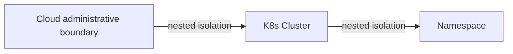

# ADR 001: Application Isolation

**Status:** Accepted | **Date:** 2026-07-11 | **Review:** 2027-07-11

## Context

Not isolating applications and environments can lead to significant
security risks. The risk of lateral movement means threats of
vulnerability exposure of a single application can compromise other
applications or the entire environment. This lack of isolation can
enable the spread of malware, unauthorised access, and data breaches.

- [Open Web Application Security Project (OWASP) Application Security
  Verification Standard
  (ASVS)](https://owasp.org/www-project-application-security-verification-standard/)
- [Australian Cyber Security Centre (ACSC) Guidelines for System
  Hardening](https://www.cyber.gov.au/resources-business-and-government/essential-cyber-security/ism/cyber-security-guidelines/guidelines-system-hardening)
- [ACSC Guidelines for Networking](https://www.cyber.gov.au/business-government/asds-cyber-security-frameworks/ism/cyber-security-guidelines/guidelines-for-networking)

## Decision

Applications and environments must be isolated by default. The selected
boundary must reflect information sensitivity, criticality, trust,
administrative ownership, and the consequence of compromise.

Use the strongest practical combination of these nested boundaries:

1. **Cloud administrative boundary**: Separate environments or security
   domains using an AWS account, Azure subscription, or Google Cloud
   project. An Azure resource group is a lifecycle and organisation scope;
   it is not equivalent to an account, subscription, or project isolation
   boundary.
2. **Network or compute boundary**: Use separate virtual networks,
   clusters, or equivalent runtime boundaries where workloads have
   different trust, ownership, or exposure.
3. **Workload boundary**: Use namespaces, identities, network policy,
   quotas, and runtime controls for related workloads that may safely share
   infrastructure. A namespace alone is not a security boundary.

Within each boundary:

- Deny network traffic by default and allow only documented flows required
  for service operation
- Separate production from non-production and separate administrative paths
  from user traffic
- Isolate data stores from direct Internet access and from workloads that do
  not require them
- Apply Kubernetes `NetworkPolicy`, security groups, firewalls, or equivalent
  controls; a namespace alone is not a network security boundary
- Authenticate and encrypt supported Kubernetes service-to-service traffic and
  authorise it by workload identity. Proposed [ADR 021: Workload mTLS and Service
  Authorisation](021-workload-mtls.md) defines the preferred Linkerd implementation
  profile and requires project approval until accepted
- Control and log ingress, egress, and cross-boundary traffic per [ADR 006:
  Automated Policy Enforcement](../operations/006-policy-enforcement.md) and
  [ADR 007: Centralised Security Logging](../operations/007-logging.md)

### Provider Examples

These examples map the durable boundary requirement; they are not mandated
products:

- [AWS accounts](https://docs.aws.amazon.com/organizations/latest/userguide/orgs_best-practices_member-acct.html)
- [Azure subscriptions](https://learn.microsoft.com/en-us/azure/cloud-adoption-framework/ready/landing-zone/design-area/resource-org-subscriptions)
- [Google Cloud projects](https://cloud.google.com/resource-manager/docs/cloud-platform-resource-hierarchy)

### Legacy Transition

Legacy and on-premises systems may migrate progressively. Agencies must
inventory trust boundaries, first restrict and monitor cross-boundary
traffic, then separate administrative access and production from
non-production. Migrate the highest-consequence systems first against
owned milestones; record interim segmentation and monitoring as
compensating controls.

## Required Evidence

- Current data-flow or network diagram identifying trust boundaries
- Approved allow-list of cross-boundary flows and business owners
- Configuration showing default-deny controls and environment separation
- Service identity, mTLS, and service-authorisation evidence for supported Kubernetes
  workloads
- Periodic test results demonstrating that prohibited paths are blocked

## Exceptions

An exception must identify the unavailable primary control, compensating
controls, affected services and information, residual risk, executive
approval, expiry date, and reassessment date.

## Consequences

**Benefits:**

- Enforceable network microsegmentation that limits lateral movement
- Simplified incident containment and forensic analysis
- Compliance with regulatory isolation requirements

**Risks if not implemented:**

- Single vulnerability compromising multiple applications
- Difficult incident response across shared environments
- Data breaches through unauthorised cross-system access
