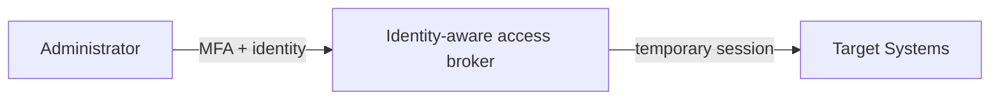

# ADR 012: Privileged Remote Access

**Status:** Accepted | **Date:** 2026-07-11 | **Review:** 2027-07-11

## Synopsis

- **Use when:** Administrators need remote privileged access to production,
  cloud, legacy, or on-premises targets.
- **Avoid when:** The path requires direct Internet-exposed administration,
  standing privilege, shared credentials, unmanaged jump hosts, missing MFA, or
  unrecorded sessions.
- **Decision:** Broker privileged access through an approved identity-aware
  service using named identities, MFA, just-in-time approval, automatic expiry,
  managed devices, recording, logging, and tested break-glass access.
- **Required evidence:** Privileged identity and entitlement inventory, MFA and
  approval records, access reviews, session records, and break-glass tests.
- **Dependencies:** [ADR 007: Centralised Security
  Logging](../operations/007-logging.md) for session records and [ADR 010:
  Infrastructure and Configuration as Code](../operations/010-configmgmt.md) for
  routine infrastructure changes.

## Context

Persistent administrative exposure, standing privilege, shared credentials,
and unrecorded sessions create material risk. A managed bastion, VPN, or
other transport is not inherently unsafe when identity-aware access,
just-in-time elevation, recording, and equivalent controls are enforced.

- [ACSC Information Security Manual
  (ISM)](https://www.cyber.gov.au/resources-business-and-government/essential-cyber-security/ism)
- [WA SOC Cyber Network Management
  Guideline](https://soc.cyber.wa.gov.au/guidelines/network-management/)

## Decision

Privileged remote access must pass through an agency-approved,
identity-aware access broker that grants recorded, just-in-time (JIT)
access to named users for an approved task. Targets must not expose direct
administrative ports to the Internet.

Direct production SSH/RDP, shared credentials, unmanaged jump hosts, and
standing privileged entitlements are prohibited. A managed bastion or VPN
may carry administrative traffic only when the same identity, MFA, JIT,
approval, expiry, device, session recording, and logging controls are met.

**Access Controls:**

- Use dedicated privileged identities that are separate from standard user
  identities and are not used for email or general web browsing
- Require phishing-resistant multi-factor authentication for privileged
  access where supported; document any temporary fallback method
- Validate access before granting it and recertify privileged entitlements
  at least quarterly
- Grant access just in time for an approved task and automatically expire
  sessions and elevated entitlements
- Bind access to a named identity and approved target, role, command or
  protocol, purpose, and duration
- Require approval appropriate to privilege and consequence
- Session recording and audit logging per [ADR 007: Centralised Security Logging](../operations/007-logging.md)
- Use managed and compliant administrative devices or isolated secure
  administration environments for privileged sessions
- Maintain separately controlled, monitored, and tested break-glass access
  for identity or control-plane failure

**Implementation:**

- Prefer outbound target connections or private paths over inbound
  administrative exposure
- Use short-lived credentials and prohibit reusable private keys where a
  brokered alternative exists
- Real-time monitoring and alerting
- Integration with SIEM systems
- Use Infrastructure as Code for routine changes per [ADR 010:
  Infrastructure as Code](../operations/010-configmgmt.md)

### Provider Examples

These are non-exclusive mappings and must be configured to meet all controls:

- [AWS Systems Manager Session Manager](https://docs.aws.amazon.com/systems-manager/latest/userguide/session-manager.html)
- [Azure Bastion](https://learn.microsoft.com/en-us/azure/bastion/bastion-overview)
  with [Microsoft Entra PIM](https://learn.microsoft.com/en-us/entra/id-governance/privileged-identity-management/pim-configure)
- [Google Cloud IAP TCP forwarding](https://cloud.google.com/iap/docs/using-tcp-forwarding)
  with [Privileged Access Manager](https://cloud.google.com/iam/docs/pam-overview)

### Legacy Transition

Legacy and on-premises targets may retain a managed bastion or VPN during
transition. Federate named identities, remove shared credentials, require
MFA and JIT approval, centralise logs, and add session recording where
technically possible. Prioritise Internet-exposed and high-consequence
systems under an owned migration plan; document interim controls and dates.

## Required Evidence

- Privileged identity and entitlement inventory, including owners
- MFA policy, approval record, session expiry, and quarterly access-review
  evidence
- Session and administrative activity records in the central logging
  platform
- Break-glass custody, alerting, and test records

## Exceptions

Persistent privilege, direct Internet administrative access, shared
credentials, non-MFA access, or unrecorded sessions require a time-bound
risk record with compensating controls, residual risk, executive approval,
expiry date, and reassessment date.

## Consequences

**Benefits:**

- Zero-trust network access with session recording
- Enhanced audit capabilities through centralised logging
- Short-lived credential security reducing persistent threats

**Risks if not implemented:**

- Unauthorised lateral movement across network systems
- Prolonged security breaches from persistent access
- Non-compliance with government zero-trust requirements
