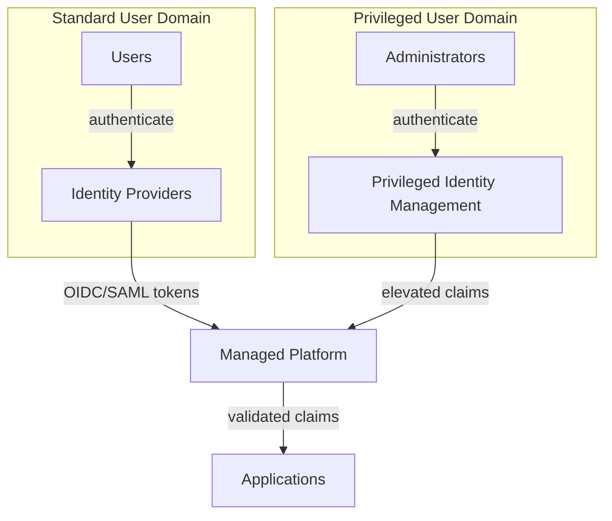

# ADR 013: Identity Federation Standards

**Status:** Accepted | **Date:** 2026-07-11 | **Review:** 2027-07-11

## Synopsis

- **Use when:** Integrating new interactive user identities or workload
  identities across enterprise, citizen, privileged, or cloud identity domains.
- **Avoid when:** SAML is selected despite available OIDC support, identity
  domains are collapsed despite different assurance needs, or legacy
  authentication can bypass MFA.
- **Decision:** Standardise new interactive federation on OIDC, retain SAML only
  for unavoidable legacy integration, use workload federation for non-human
  identities, and govern identity domains separately.
- **Required evidence:** Relying-service register, identity-policy exports,
  authentication events and alerts, and annual federation, key-rollover,
  recovery, and fallback tests.
- **Dependencies:** [ADR 012: Privileged Remote Access](012-privileged-remote-access.md)
  for privileged access and [ADR 007: Centralised Security
  Logging](../operations/007-logging.md) for authentication audit trails.

## Context

Applications need to integrate with multiple identity providers
including jurisdiction citizen identity services, enterprise
directories, and cloud identity platforms. Current approaches use
inconsistent protocols (SAML, OIDC, proprietary) creating integration
complexity and security inconsistencies.

The controls differ for employees, citizens, administrators, and software.
Treating them as one identity domain creates inappropriate assurance,
lifecycle, privacy, and access decisions.

- [Digital ID Act 2024](https://www.legislation.gov.au/C2024A00025/latest/text)
- [OpenID Connect Core 1.0](https://openid.net/specs/openid-connect-core-1_0.html)
- [OWASP Authentication Cheat Sheet](https://cheatsheetseries.owasp.org/cheatsheets/Authentication_Cheat_Sheet.html)
- [EU Digital Identity Wallet Architecture and Reference Framework
  (ARF)](https://eudi.dev/) - European digital wallet standards
- [ISO/IEC 18013-5:2021 Mobile Driving
  Licence](https://www.iso.org/standard/69084.html) - mobile identity
  document standard

## Decision

Standardise on OpenID Connect (OIDC) as the primary protocol for new
interactive user federation, with SAML 2.0 support only where an upstream
provider or legacy relying party cannot support OIDC. Use the applicable
workload-federation protocol for non-human identities.

Define separate policies and trust boundaries for:

- **Workforce identities**: employees, contractors, and partners, with
  joiner, mover, leaver and entitlement governance
- **Customer or citizen identities**: privacy-preserving registration,
  recovery, consent, fraud controls, and service-specific assurance
- **Privileged identities**: separate administration identities with JIT
  elevation and controls from [ADR 012](012-privileged-remote-access.md)
- **Workload identities**: non-human identities using federation and
  short-lived tokens instead of user accounts or long-lived keys

**Protocol Standards:**

- **Primary**: OpenID Connect for modern identity providers and new
  integrations
- **Legacy Support**: SAML 2.0 only when upstream providers require it
  and OIDC is unavailable
- **Security**: Use the OIDC Authorization Code flow with PKCE for browser,
  native, and public clients; do not use the implicit flow. Validate issuer,
  audience, signature, nonce, state, expiry, and authorised redirect URIs.
- **Compliance**: Assess the Digital ID Act 2024, Accreditation Rules, and
  Australian Government Digital ID System requirements only where the
  agency is providing, seeking accreditation for, or participating in a
  service within their scope. The Act is not a blanket technical mandate
  for every agency login.

**Architecture Requirements:**

- Use a managed identity platform where it reduces security and lifecycle
  risk. Introduce an identity broker only when multiple upstream providers,
  protocol translation, central policy, or migration needs justify the
  added dependency and concentration risk
- Separate privileged and standard user domains for administrative
  access isolation (see [Reference Architecture: OpenAPI
  Backend](../reference-architectures/openapi-backends.md))
- Support the upstream identity providers required by the service without
  embedding provider-specific identity logic throughout application code
- Maintain audit trails per [ADR 007: Centralised Security
  Logging](../operations/007-logging.md)
- Require multi-factor authentication (MFA) for workforce users, remote
  access, privileged access, and Internet-facing services according to
  information sensitivity and service risk
- Prefer phishing-resistant authenticators such as passkeys, security keys,
  or certificate-backed device authentication; do not use SMS or voice as
  the target state
- Disable legacy authentication protocols that bypass MFA
- Record successful and failed authentication, MFA registration and reset,
  token anomalies, account recovery, and privileged elevation events
- Define fallback authentication for critical services without weakening
  normal MFA requirements or leaving an unmonitored bypass

**Identity Federation Flow:**

Where used, the managed platform handles protocol translation, token
validation, policy, and audit logging.

**Provider Examples:**

Customer and citizen identity options include [Amazon Cognito user
pools](https://docs.aws.amazon.com/cognito/latest/developerguide/cognito-user-pools.html),
[Microsoft Entra External ID](https://learn.microsoft.com/en-us/entra/external-id/customers/overview-customers-ciam),
and [Google Cloud Identity Platform](https://cloud.google.com/identity-platform/docs).
These examples are not mandated and do not replace assurance, privacy,
residency, accessibility, recovery, and exit assessments.

**Roadmap:**

- Monitor [W3C Verifiable Credentials](https://www.w3.org/TR/vc-data-model/),
  [OpenID4VC](https://openid.net/openid4vc/), and
  [ISO/IEC 18013-5](https://www.iso.org/standard/69084.html). Adopt them
  only for an approved use case with mature interoperability, privacy,
  revocation, recovery, and trust-framework support. They are not current
  federation requirements.

**Implementation Requirements:**

- Choose identity platforms with high availability and data export
  capabilities
- Document the required authentication assurance for each relying service
- Test federation metadata, signing-key rollover, account recovery, and
  critical-service fallback at least annually

This ADR covers federation and authentication. Detailed identity lifecycle,
entitlement review, compromised-password filtering, and workload identity
standards remain agency implementation requirements.

## Required Evidence

- Relying-service register with protocol, MFA, assurance, and fallback
  requirements
- Identity-provider policy exports showing MFA and legacy-authentication
  settings
- Authentication-event coverage and alert tests in the central logging
  platform
- Annual federation, key-rollover, recovery, and fallback test records

## Exceptions

Any service that cannot meet the required MFA or federation controls must
record compensating controls, affected identities and information, residual
risk, executive approval, migration date, expiry date, and reassessment
date.

## Consequences

**Benefits:**

- Consistent modern federation standard across all applications
- Better security through OIDC's improved token handling and PKCE
  support
- Simplified integration with jurisdiction citizen identity services
- Clear separation of administrative and standard user access

**Risks if not implemented:**

- Fragmented authentication systems across applications
- Legacy SAML limitations hindering citizen service integration
- Inconsistent security posture across identity touchpoints
