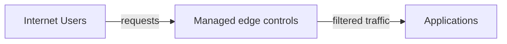

# ADR 016: Web Application Edge Protection

**Status:** Accepted | **Date:** 2026-07-11 | **Review:** 2027-07-11

## Context

Government web applications face heightened security threats including
state-sponsored attacks, DDoS campaigns by activist groups, and
sophisticated application-layer exploits targeting public services.
These attacks can disrupt critical citizen services and damage public
trust.

Traditional perimeter security is insufficient for modern web services.
Managed edge, DDoS, and application controls can reduce exposure before
traffic reaches an origin, but the appropriate services depend on threat,
availability, performance, architecture, and consequence.

References:

- [ACSC Information Security Manual
  (ISM)](https://www.cyber.gov.au/resources-business-and-government/essential-cyber-security/ism)
- [ACSC Guidelines for System
  Hardening](https://www.cyber.gov.au/acsc/view-all-content/publications/hardening-linux-workstations-and-servers)
- [OWASP Web Application Security Testing
  Guide](https://owasp.org/www-project-web-security-testing-guide/)

## Decision

Internet-facing web applications and APIs must use agency-approved,
risk-appropriate managed edge and DDoS protection. Use a WAF where HTTP
threats warrant it. Use a CDN when caching, geographic delivery, origin
shielding, or edge capacity provides a documented benefit; a CDN is not
required for every service.

The edge may provide TLS termination, routing, caching, WAF filtering, bot
controls, and DDoS mitigation before traffic reaches the origin.

**Edge Requirements:**

- Size DDoS protection and escalation support for the assessed service
  availability risk
- Configure caching and origin shielding only where content and privacy
  rules permit them
- Prefer object-backed origins for cacheable static and media assets, using
  [ADR 019: Shared File Access](../operations/019-shared-file-access.md) when
  authoring or processing workloads need file-system access
- Enable IPv6 dual-stack at the edge where the selected service and client
  compatibility support it; document any material accessibility or transition
  constraint
- Prevent clients from bypassing the edge by restricting origins to
  authenticated edge traffic or an equivalent private path
- Use agency-approved TLS versions and certificates at the edge and origin
- Apply appropriate HTTP security headers, including transport security and
  content-type protection; define Content Security Policy per application

**WAF Protection:**

- Select managed and custom rules for evidenced threats. WAF rules do not
  cover all OWASP Top 10 risks and do not fix insecure application design
- Layer 7 DDoS protection and rate limiting
- Apply geo-blocking and bot management only where justified and tested for
  service accessibility impacts
- Custom rules for application-specific threats
- Introduce new and materially changed rules in log or count mode, review
  false positives, then progress through sampled or scoped blocking to full
  enforcement. Urgent threat rules may use expedited approval and review

**Provider Examples:**

Options include [AWS WAF and Shield](https://docs.aws.amazon.com/waf/latest/developerguide/what-is-aws-waf.html),
[Azure Web Application Firewall and DDoS Protection](https://learn.microsoft.com/en-us/azure/web-application-firewall/overview),
and [Google Cloud Armor](https://cloud.google.com/armor/docs). CDN options
include [Amazon CloudFront](https://docs.aws.amazon.com/AmazonCloudFront/latest/DeveloperGuide/Introduction.html),
[Azure Front Door](https://learn.microsoft.com/en-us/azure/frontdoor/front-door-overview),
and [Cloud CDN](https://cloud.google.com/cdn/docs/overview). These mappings
are non-exclusive and must meet the same durable controls.

**Implementation:**

- WAF logs integrated with SIEM per [ADR 007: Centralised Security
  Logging](../operations/007-logging.md)
- Default to fail secure. Document and pre-approve any emergency failure
  mode, including who may activate it, service and data scope, compensating
  monitoring and rate limits, maximum duration, notification, and review
- Regular penetration testing and rule tuning
- CI/CD integration for automated deployments
- Alert on direct-origin attempts, WAF bypass, material rule changes, and
  sustained blocking or rate-limit events

The WAF and CDN are compensating layers, not substitutes for patching,
server hardening, application security testing, authentication, or secure
coding.

## Required Evidence

- Applicable edge, DDoS, WAF, TLS, origin-access, and security-header
  configuration, including the risk rationale where CDN or WAF is omitted
- Current Internet-facing service and origin inventory
- WAF rule tests, penetration-test results, and rule-tuning records
- Alerts and central logs for blocked traffic and configuration changes

## Exceptions

Any public origin or service without its assessed edge controls, or use of
an emergency failure mode beyond its approval, needs a time-bound exception
that records compensating controls, residual risk, executive approval,
expiry date, and reassessment date.

## Consequences

**Benefits:**

- Automated threat detection and mitigation at network edge
- Content delivery and caching where the service needs them
- Reduced origin exposure through filtering
- Real-time traffic analysis and bot management

**Risks if not implemented:**

- Critical citizen services disrupted by attacks
- Direct server exposure to malicious traffic
- Slow response times affecting user adoption
- No early warning of emerging attack patterns
