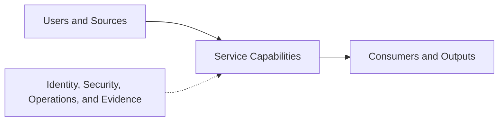

# Reference Architecture: Pattern Name

**Status:** Proposed | **Date:** YYYY-MM-DD | **Review:** YYYY-MM-DD

Set `Review` to one year after `Date`.

Reference architectures are informative compositions of ADRs. Mandatory
requirements must come from Accepted ADRs or other authoritative policy. Label
Proposed dependencies, optional examples, and unresolved decisions explicitly.

## Purpose

Describe the service outcome and the intended audience in two or three sentences.

## Applicability and Non-Goals

Use this pattern when:

- Service or project condition 1 applies
- Service or project condition 2 applies

Do not use it when a simpler pattern is sufficient. State related capabilities
that remain outside scope.

## How to Use This Reference Architecture

| Dependency | Status | Application in this pattern |
|------------|--------|-----------------------------|
| ADR ###: Related decision | Accepted | Requirement applied here |
| ADR ###: Proposed decision | Proposed dependency | Project approval needed before reliance |

Do not use this page to silently decide a missing standard. Add unresolved
foundational decisions to the proposed-decision backlog.

## Assumptions and Prerequisites

- Accountable business, information, technical, security, operational, and
  accessibility owners are identified
- Users, critical journeys, classification, privacy, sharing, records,
  offshoring, service objectives, budget, support, and legacy constraints are
  known
- Required identity, networking, logging, recovery, supplier, and delivery
  capabilities are available or have an owned plan

## Architecture Variants

| Variant | Shape | Typical fit |
|---------|-------|-------------|
| Minimum | Smallest useful capability set | Low complexity and consequence |
| Standard | Shared or integrated capabilities | Repeated agency use |
| Higher assurance | Stronger isolation, evidence, resilience, and support | Sensitive or critical services |
| Legacy transition | Controlled coexistence and migration | Supported existing estates |

Select only the capabilities the service needs. Variants are not assurance
claims by themselves.

## Capability View

Describe trust boundaries and provider-neutral responsibilities before naming
products.

## Implementation Options

| Estate | Non-equivalent examples | Selection considerations |
|--------|-------------------------|--------------------------|
| AWS | Official service links | Region, security, recovery, cost, and exit |
| Azure | Official service links | Region, security, recovery, cost, and exit |
| Google Cloud | Official service links | Region, security, recovery, cost, and exit |
| SaaS or legacy | Supported product or existing platform | Contract, support, data handling, migration, and exit |

Examples are not standards. Prefer OpenTofu, or Terraform where justified, for
provisionable infrastructure under ADR 010.

## Project Kickoff Artifacts

- Service brief, scope, selected variant, outcomes, and non-goals
- Ownership and responsibility matrix
- Current and target architecture, trust-boundary, and data-flow diagrams
- Classification, privacy, sharing, records, offshoring, supplier, and
  accessibility assessments as applicable
- Service objectives, support model, threat model, cost envelope, recovery,
  migration, and exit plans
- ADR dependency and project-decision record

## Roles and Operating Model

Name owners for service outcomes, information, platform, suppliers, security,
privacy, records, accessibility, support, incidents, changes, recovery, cost,
and exit.

## Assurance Considerations

Address:

- Security, identity, classification, privacy, sharing, and offshoring
- Accessibility and assisted-digital needs
- Logging, service levels, capacity, cost, incident response, and supplier
  escalation
- Independent backup, resilience, degraded operation, and recovery tests
- Legacy migration, data and configuration export, rollback, and decommissioning

## Acceptance Checks

- [ ] Applicability, selected variant, owners, and non-goals are approved
- [ ] Mandatory statements trace to Accepted ADRs or authoritative policy
- [ ] Proposed dependencies and project-specific decisions are explicitly approved
- [ ] Architecture, data flows, trust boundaries, and provider responsibilities
      are documented
- [ ] Functional, security, privacy, accessibility, performance, resilience,
      recovery, and operational checks pass for representative journeys
- [ ] Runbooks, monitoring, support, supplier escalation, migration, and exit are
      tested or have an approved plan

## Related Decisions

- ADR ###: Related Decision
